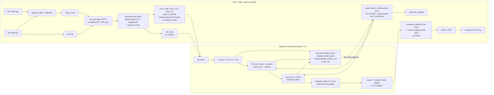

# Align-ULCNet

Hybrid `linear AEC -> joint RES + NR` reference candidate. Inputs are the
**frozen production linear-AEC error** and far-end reference. That frontend
runs on the context-only seam (`enable_res=0`, `return_res_context=1`) and the
error is its analysis seam (`get_formed_output()`, the C `formed_hop`): the real
selected linear residual of every hop, which can exceed the capture on a hop
where the rendering guard of `lib/aec` would publish the capture. The guard
selects the rendering base only and never alters this input; see
`dataset_gen/README.md`, "The `linear_error` front-end contract". The target is
the common denoised, echo-free, early/dereverberated near-end speech. It is
not a direct neural AEC. This target is the project's comparison contract and
should not be reported as an upstream checkpoint-equivalent setting.

The implementation follows arXiv:2410.13620: component-wise power-law
compression; separate 32-channel NE/error and FE streams; two separable
convolutions per stream and max-pooling; 32-channel latent cross-attention;
ordinary joint convolutions with 64/96 channels; a 64-unit frequency GRU; two
parallel, two-layer 128-unit temporal subband GRUs; two full-band FC layers;
and the ULCNet second-stage CNN complex mask. The compressed real/imaginary
estimate is decompressed component-wise.

C-SamFR follows Figure 2 at the subband level. On the 16 kHz grid, `K=257`,
`K_B=2`, `gamma=5` pads to 130 subbands and produces five 52-bin channels; the
same formula derives the larger 48 kHz widths from `K=513`. It does not
interleave individual FFT bins and break two-bin subbands apart.

Paper defaults are 16 kHz, `512/512/256`, 3-second samples, `alpha=0.3`, and a
64-frame (~1 s) delay buffer. The project ships two grids, and every width
below is derived from `n_fft` rather than written down anywhere:

| grid | `n_fft`/win/hop | `K` (bins) | C-SamFR channel width | attention `ta_bins` | hop duration |
| --- | --- | ---: | ---: | ---: | ---: |
| 16 kHz | `512/512/256` | 257 | 52 | 26 | 16.00 ms |
| 48 kHz | `1024/1024/512` | 513 | 104 | 52 | 10.67 ms |

Those two are the only supported grids: `export_onnx.py` rejects anything else
(`SUPPORTED_GRIDS`), and `ulcnet_model_io.h` refuses to compile off them.
Changing grids also changes learned frequency-axis tensor shapes (including
the reorientation, bottleneck and fully connected layers). A 16 kHz checkpoint
therefore cannot be exported or deployed as 48 kHz: train a separate 48 kHz
checkpoint from a matching packed corpus. This is different from changing D,
whose history length changes the streaming contract but not the weight shapes.

On the training side the grid comes from `[signal] sr`/`n_fft` in `config.ini`.
On the C side it is a build parameter, selected by name:

```bash
make                       # 16 kHz (the default)
make ULCNET_GRID=48k       # 48 kHz
make test-grids            # build and test BOTH, in separate object dirs
```

`ULCNET_GRID` reaches only the ULCNet translation units and is folded into the
pipeline `CFG_SIG`, so the two grids never share an object directory and the
AEC/NR/audiolib/common producer archives -- which contain no ULCNet code -- are
not rebuilt when the grid changes. Passing the two `-D` flags through
`EXTRA_CFLAGS` also works but does forward them to those producers, splitting
their caches for nothing.

D does **not** carry across the two grids, because the hop it counts is a
different length. A depth D reaches `(D-1)` hops back, so D=8 reaches 112 ms at
16 kHz but only 74.7 ms at 48 kHz; matching the 16 kHz reach needs D=12 there.
Deriving D from one physical second is also not available at 48 kHz: that comes
to 94 frames, above the `D <= 64` ceiling that `export_onnx.py`
(`MAX_DELAY_DEPTH`) and the C runtime (`ULCNET_MODEL_IO_MAX_D`) both enforce.
So on the 48 kHz grid `[model] max_delay_frames` must be set explicitly -- a
run that leaves it to the one-second default trains, then fails at export. The
shipped 16 kHz training `config.ini` sets D=32 explicitly.

The two standalone examples (`mono_alignulcnet`, `4ch_alignulcnet`) read their
delay settings from file-head macros, so a per-SKU build can bake in a measured
profile instead of passing flags on every run:
`ULCNET_EXAMPLE_DELAY_FRAMES` (D, default 8) and
`ULCNET_EXAMPLE_DELAY_NUM_FILTERS` (MATCHED bank size n, default
`DA_NUM_FILTERS` = 5). Both are compile-time only: D must equal the D the model
was exported with, and n sizes the matched bank, so changing either means a
rebuild and a fresh pool query. `--delay-num-filters` still overrides n at run
time, and n applies to MATCHED alone -- the other two delay modes build no bank
and `aec_validate_config()` requires n == 5 there, so the example resets it.
Each macro reaches a single translation unit, so `EXTRA_CFLAGS` carries them:

```sh
make EXTRA_CFLAGS=-DULCNET_EXAMPLE_DELAY_NUM_FILTERS=3 mono_alignulcnet
```

Out-of-range values fail to compile rather than at run time. The producer-cache
caveat above applies here too.

No author code/checkpoint was released. The paper leaves activation details inside the FC pair unspecified;
those remain a reconstruction choice. The 16 kHz graph has about 0.67 M
trainable parameters, matching the published 0.69 M class without inventing a
U-Net decoder.

For training, `[model] max_delay_frames` in `config.ini` directly selects D;
the shipped config uses D=32.  The delay-stack activation and
streaming state grow linearly with D, so this is also the first memory knob to
reduce when a D=64 run exhausts CUDA memory.  This is a real forward-path
choice, not only an allocation hint: changing D changes the attention candidate
set.  Start a new run after changing it; checkpoint resume deliberately rejects
a different D.  If memory is still insufficient, reduce `[data] batch_size`.

## Training recipe

The shipped `config.ini` uses the published optimizer and peak LR: Adam at
`4e-3`. It then applies the project-wide schedule: three local epochs of linear
warmup from `1e-4`, followed by per-optimizer-step cosine decay to `1e-6` over
the remaining 50-epoch budget. This gives every run a deterministic LR curve
rather than one driven by validation noise.

Early stopping is disabled (`early_stop_patience=0`). Validation still selects
`*_best.pth`.

The loss is ULCNet's component-wise signed power compression followed by
frequency-domain MSE (`c=0.3`).

The primary source is arXiv:2410.13620. It explicitly publishes Adam, `4e-3`,
D=64, batch 64, 3-second examples, a 20,000-step epoch, and the `0.1` plateau
reduction. It does not state weight decay, AMSGrad, an LR floor, or an early-stop
rule. The shipped config uses D=32, batch 16, the warmup/cosine schedule and a
50-epoch budget instead.

For the listening examples on the paper's project page, the track labelled
``KF`` is the 16 kHz **error/residual Z**, not the KF echo estimate. To test
only this neural post-filter with that external frontend, use:

```bash
python3 inference.py checkpoint.pth official_err.mp3 official_lpb.mp3 out.wav \
  --input-is-linear-error
```

The page's ``mic``/``lpb`` tracks are 48 kHz while ``err`` is 16 kHz; the
script converts both to the checkpoint rate. Omit the flag to test the complete
repository flow (48 kHz mic/lpb -> resample -> frozen PBFDKF -> Align-ULCNet).
The external KF uses different parameters and is not bit-equivalent to PBFDKF.

## C/Python inference parity and alignment events

The C ULCNet stage (`pipelines/ulcnet/ulcnet_nn_stage.c`, `gate_delay`) and
Python inference (`inference.py` -> `_streaming.py`) differ at alignment events:

| | C stage | Python inference |
|---|---|---|
| event | `delay.changed`, or the first transition to solid after the first hop | not detected: `lib/aec/python` has `get_post_reset_serial` but no equivalent of `AecLinearContext.delay_state` |
| model state | `model->reset` zeroes every state tensor (attention ring, logit history, recurrent state) | never reset, runs continuously |
| frames | `ULCNET_NN_STAGE_REPRIME_FRAMES` (1) identity frame | every frame goes through the model |

The reset policy is C-only for now; this is a documented divergence (function
map D-44, row PL-ULC-01) and predates `aiaec-linear-error-v4`. It does not
change the front-end contract or the model I/O layout. Asking `lib/aec` for a
Python event accessor so that Python can mirror the policy is a separate
decision.

Consequently the C/Python inference comparison of a checkpoint is defined only
over spans without alignment events:

1. **Event-free by construction (primary).** Python
   `inference.py --input-is-linear-error` against the C stage fed the same
   `linear_error` and `far` with `delay = {changed 0, solid 1}` on every hop.
   Neither side has an AEC, so neither has an event; both start from zeroed
   state. Compare the whole stream after hop #0.
2. **AEC in the loop.** Every real clip has at least one event (the lock), so
   compare only (a) from the stream start up to the frame before the first
   event hop, and (b) from the last event hop plus the attention depth `D`
   frames plus a settling margin. The margin has to be measured on the
   delivered checkpoint (the recurrent state is not guaranteed to forget at a
   known rate); frames in between are expected to differ and are not a defect.
   Take the event hops from the C side (the stage's `delay` argument, logged per
   hop). A change of `applied_delay_samples` in the sweep alignment trace is
   only a proxy for them.

No committed test drives the stage against Python (function map T-15); until
the owner's checkpoint exists, either comparison can run only on a synthetic
checkpoint. The model-level pieces (`ulcnet_model_io`, `ulcnet_prepost`) are
independent of alignment events and keep their own C tests.

## Streaming delay-profile sweep

`sweep_delay_depth.py` runs the same checkpoint through the real
`forward_stream()` path at several fixed delay depths.  The PBFDKF frontend
and STFT inputs are computed once, so the resulting WAV differences come only
from D.  Each run writes a float WAV, a frame-by-frame delay trace, the AEC
alignment trace, and one row in `summary.csv` containing the resolved delay
profile, state RAM, Python RTF, boundary-hit rate, and the waveform difference
from the checkpoint's D:

```bash
python3 sweep_delay_depth.py checkpoint.pth mic.wav far.wav d_sweep \
  --depths 64,32,16,8,4 --device cuda
```

A delay profile has two independent halves and the tool drives both:

| knob | flag | fixed at | governs |
|---|---|---|---|
| matched-filter bank size `n` | `--delay-num-filters` | AEC init | how far the bulk far-to-mic delay search reaches, and AEC pool |
| alignment depth `D` | `--depths` | ONNX export | how many past 16 ms frames the attention keeps, and model state |

They are not one delay budget: each layer only has to satisfy the input
condition the previous one delivers, which is why both appear in every summary
row instead of being summed.  Reliable reach of the bank is 125 / 221 / 317 /
413 / 509 ms for `n` = 1..5.

`--delay-num-filters` is a **runtime AEC init override** for the deployment or
diagnostic frontend. It is not a checkpoint-compatibility or retraining
requirement:
dataset generation remains frozen at `n = 5`, while a product may choose a
smaller n when its measured bulk-delay range plus acquisition margin fits that
bank. Omitting the flag reproduces the dataset-generation frontend. The bank
size recorded in `summary.csv` is read back from the constructed engine, so a
row cannot name a profile the run did not actually execute.

The normal streaming inference CLI exposes the same deployment override:

```bash
python3 inference.py checkpoint.pth mic.wav far.wav out.wav \
  --delay-num-filters 2
```

The default remains `n = 5`. The flag is rejected together with
`--input-is-linear-error`, because that mode bypasses PBFDKF and therefore has
no matched-filter bank to resize.

The matched-filter bank and the NN far input are independent. To reproduce the
checkpoint's training provenance while retaining PBFDKF delay estimation for
the linear-error input, run:

```bash
python3 inference.py checkpoint.pth mic.wav far.wav out.wav \
  --delay-num-filters 5 --far-input-mode raw_far
```

`raw_far` changes only the NN branch; PBFDKF still runs with `n = 5` and
produces `linear_error`. It is the training and deployment default.
`aligned_far` remains available only as an explicit diagnostic comparison.

```bash
# short-route candidate: smaller bank, aligned far, shallow attention
python3 sweep_delay_depth.py checkpoint.pth mic.wav far.wav short_route \
  --far-input-mode aligned_far --delay-num-filters 2 --depths 8,4
```

For a published or external KF residual, add `--input-is-linear-error` (it
bypasses PBFDKF entirely, so it cannot be combined with a bank-size override).
An aligned clean reference may be supplied with `--target-wav` to add SNR and
SI-SDR columns.  To test the proposed small-D deployment seam, add
`--far-input-mode aligned_far`; the tool then feeds the NN the post-delay-
buffer far samples that PBFDKF actually consumed.  In
`--input-is-linear-error` bypass mode it cannot recover that internal tap, so
the supplied far WAV is explicitly assumed to be pre-aligned.

Every clip is QA'd against an **estimator-independent** offline measurement of
the bulk delay: a windowed, energy-gated, normalized cross-correlation of the
raw far against the raw mic.  The applied delay must land at, or just before,
that measurement.  A clip that fails is reported as `mislock` and marked
invalid (`qa_valid` in `summary.csv`) so it cannot be averaged into a
delay-profile statistic. A delay outside the selected bank's reliable range
that stays unlocked is reported as valid `not_acquired`; failure to acquire a
decidable in-range delay is `not_acquired_in_range` and invalid.

The Python RTF is only a relative D comparison on the same machine; it does
not predict NPU runtime.  Compare the boundary rates/probability with the
uninformative softmax baseline `1/D`: a boundary value near that baseline may
only mean that attention is diffuse, whereas a trained head repeatedly
concentrating at the oldest slot suggests D is too small.  Listen to every
generated WAV and validate task metrics before fixing D in an ONNX export.

## Stateless accelerator deployment

The accelerator is assumed to retain no state between invocations.  CPU/DSP
code owns every K/V, score-convolution and GRU tensor in caller-provided
memory.  Align-ULCNet is a postfilter, so microphone PCM first enters the
linear AEC; the learned graph consumes `linear_error`, not raw microphone.

After the separate batch-1 cleanup (`onnx_batch1_optimizer.py`, run last on the exported file), each
convolution's frequency-axis zero padding sits in the Conv `pads` attribute (`fold_frequency_pad_into_conv`) and
no separate Pad op feeds a Conv; the temporal axis is never padded (its history is a tensor).



The production graph is fixed to `batch=1`, `T=1`, real/imaginary in the last
dimension. `D` is fixed at export time; D=4 and D=8 are different ONNX tensor
contracts even though their weight shapes are identical. The portable ABI
accepts `2 <= D <= 64`; D=1 would leave a Slice that keeps zero frames, which is
not portable across target runtimes and is therefore evaluation-only.

The fixed front end never enters the quantized domain: the host computes the
signed-power compression (`sign(x) * |x|^0.3`), both magnitudes and the
compressed-domain phase as cos/sin in fp32, and the graph binds the four
feature tensors as separate inputs so each keeps its own quantization scale.
The graph ends at the `complex_mask` 1x1 Conv and returns the learned mask
itself; the fixed back end (complex multiply of the compressed error spectrum,
which `prepare()` keeps in the model-I/O state, by that mask, then the inverse
signed power) runs on the host.
The far branch is the original raw reference. PBFDKF's aligned copy is private
to formation of the linear-error branch; the model's TA block owns alignment.

The two tables below are the graph boundary (state layout version 18), the only
one `ulcnet_model_io.h` binds.

Inputs per invocation (all state tensors are rank 4):

| tensor | float32 shape | ordering |
|---|---:|---|
| `error_mag` | `[1,1,BINS]` | compressed-domain magnitude of linear error |
| `far_mag` | `[1,1,BINS]` | compressed-domain magnitude of the far branch |
| `error_cos` | `[1,1,BINS]` | cos of the compressed-domain error phase |
| `error_sin` | `[1,1,BINS]` | sin of the compressed-domain error phase |
| `key_history` | `[1,32,D,TA_BINS]` | newest first: slot 0 is t-1, slot D-1 is t-D and is never read |
| `value_history` | `[1,32,D,TA_BINS]` | newest first: slot 0 is t-1, slot D-1 is never read |
| `logit_history` | `[1,32,5,D]` | chronological: frame 0 is t-5 and is never read, frame 4 is t-1 |
| `h_gru` | `[1,4,1,128]` | NCHW; subband GRU 0 layers, then subband GRU 1 layers, stacked on dim 1 |

Outputs per invocation:

| tensor | float32 shape | CPU action |
|---|---:|---|
| `output` | `[1,2,1,BINS]` | the learned complex mask, planar (plane 0 real, plane 1 imaginary); multiply the compressed error spectrum by it, apply the inverse signed power (`sign(x) * |x|^(1/0.3)`), then WOLA/IFFT. `ulcnet_model_io_commit()` does all of this |
| `key_history_out` | `[1,32,D,TA_BINS]` | bound to the address of `key_history` |
| `value_history_out` | `[1,32,D,TA_BINS]` | bound to the address of `value_history` |
| `logit_history_out` | `[1,32,5,D]` | bound to the address of `logit_history` |
| `h_gru_out` | `[1,4,1,128]` | bound to the address of `h_gru` |

Every state tensor comes back whole with exactly its input's shape, and the
runtime binds each `*_out` to the address of the input of the same name:
`prepare()` returns `out.<state>_out == in.<state>`, fixed for the life of the
state. The runtime must finish reading every state input before it writes any
state output. There is no copy path and no ping-pong. A refused `commit()`
cannot roll back: all four state tensors restart from zero, the state
generation advances, and a run that reported failure is taken not to have
written.

The window shift happens inside the graph, on the input side. K/V (newest
first) keep the input's slots `0..D-2` through a Slice (axis 2, step 1, end
`D-1`) and the new frame is concatenated in front; the logit window keeps
frames `1..4` (end 5) and the new row is concatenated behind. The Concat result
is the attention input and also the output, so no state output is produced by a
Slice, and the one slot a window drops only keeps the input and output shapes
equal. `export_graph` checks the written file with
`validate_inplace_state_contract` (`AIAEC/_onnx_contract.py`, a wrapper over
`validate_inplace_state_graph` in `AINR/onnx_streaming_contract.py`): identical rank-4
shapes per state pair, exactly one Slice consumer per window input, no state
output produced by a Slice, and `state_binding = in_place_same_address` in the
metadata. `query_now` is not state and is not returned. Delay distribution is
debug-only and is not part of the production ABI.

`ulcnet_model_io_state_generation()` (also exposed as
`ulcnet_prepost_state_generation()` and
`ulcnet_accelerator_adapter_state_generation()`) counts the times the C side
zeroed the state tensors: `reset` and each refused `commit` add one. A board
whose accelerator keeps fixed-point state compares it with the value it last
saw and refills the state inputs with the quantized representation of zero
when it changed.

The board adapter uses the C boundary in this order (error paths fail open and
must not call `commit` with incomplete accelerator outputs):

```c
UlcnetModelIoDescriptor desc;
UlcnetModelIoMemReq req;
UlcnetModelIoInputs in;
UlcnetModelIoOutputs out;
UlcnetModelIoState *state;
void *pool;  /* board static arena address, assigned after the size query */

ulcnet_model_io_descriptor_default(8, &desc);
ulcnet_model_io_get_mem_requirements(&desc, &req);
/* Assign pool to req.bytes at req.alignment in the board's static arena. */
state = ulcnet_model_io_init(pool, req.bytes, &desc);

ulcnet_model_io_prepare(state, err_re, err_im, far_re, far_im, &in, &out);
/* Bind in.* to the accelerator inputs and every out.*_out to the address of
 * the matching in.* state (the pointers prepare() returned). The runtime
 * reads all state inputs before it writes any state output. */
if (run_accelerator(&in, &out) == 0 &&
    ulcnet_model_io_commit(state, enhanced_re, enhanced_im) == 0) {
    /* enhanced_re/im may now be sent to the synthesis (ac_istft_push_planar). */
} else {
    /* Output the linear-error hop. A refused commit zeroed all four state
     * tensors (cold start) and advanced the state generation; a frame that
     * was never committed leaves them as the accelerator wrote them. */
}
```

Export a true one-frame graph with:

```bash
python3 export_onnx.py \
  --checkpoint checkpoint.pth \
  --max-delay-frames 8 \
  --output output/align_ulcnet_d8_stream.onnx \
  --verify
```

Capture PTQ inputs for the same D with this model's calibration entry point.
`--primary-dir` holds `linear_error` WAVs that this build's front end
(`aiaec-linear-error-v4`, the AEC analysis seam) produced and that carry a stamp,
see "Linear-error provenance and stamps" below:

```bash
python3 inference.py calib \
  --checkpoint checkpoint.pth \
  --primary-dir /path/to/linear_error \
  --far-dir /path/to/raw_far \
  --frames 256 --max-delay-frames 8 \
  --format npz --output calib/align_ulcnet_d8.npz
```

For NPU tools that consume one raw file per input per invocation, select the
binary directory format:

```bash
python3 inference.py calib \
  --checkpoint checkpoint.pth \
  --primary-dir /path/to/linear_error \
  --far-dir /path/to/raw_far \
  --frames 8192 --max-delay-frames 8 \
  --format bin \
  --output calib/align_ulcnet_d8
```

The layout is `<tensor>/<tensor>_<frame>.bin`, with zero-based frame numbers;
for example `h_gru/h_gru_0000.bin`. Each file is C-contiguous and
little-endian. `manifest.json` records dtype and per-frame shape. The output
directory must not already exist, so a shorter rerun cannot leave stale frames.

Calibration and deployment use the same training-domain raw far signal; the
report records both fields so a disagreement is fail-fast. The
D value must match the exported graph because it fixes the K/V window tensor
shapes and CPU state allocation, not because changing D requires retraining.

### Linear-error provenance and stamps

The calibration tensors are recorded behind one specific front end. Stems from
the retired `aiaec-linear-error-v3` front end (or any other AEC build) hold
different statistics, so `calib` checks where a pre-made `--primary-dir` came
from. The directory must carry one of:

- `linear_error.contract.json` inside it (written by a `--primary-is-mic` run),
- a `linear_error.done.json` corpus ledger next to it that records the
  contract identity (a fingerprint-only legacy ledger is "unstamped"; a
  ledger that does not claim every chunk sequence under the directory is
  refused as a half re-rendered corpus).

The stamp must equal the checkpoint's own `linear_aec` contract. Refused, before
the ONNX graph or the artifact is written: a retired contract version or AEC
behaviour hash, a contract that differs from the checkpoint's, an internally
inconsistent stamp (its fingerprint does not match its contract), a stamp from a
seam other than `analysis_formed`, and a directory with no stamp at all
("carry no front-end stamp"). `--allow-unstamped-linear-error` waives only the
last case: it warns and the report records
`linear_error_stamp.origin = unstamped_override`. It is rejected together with
`--primary-is-mic`.

`--primary-is-mic` is the self-stamping route. Pass RAW microphone WAVs as
`--primary-dir`; the checkpoint-matched frozen PBFDKF derives the stems in
process, writes them to `<output>_linear_error/` with a
`linear_error.contract.json` made from the checkpoint's contract (written last,
so an interrupted run leaves no stamp), and the manifest records
`primary_source = raw_mic_via_frozen_pbfdkf`:

```bash
python3 inference.py calib \
  --checkpoint checkpoint.pth \
  --primary-dir /path/to/raw_mic --far-dir /path/to/raw_far \
  --primary-is-mic --frames 8192 --max-delay-frames 8 \
  --format bin --output calib/align_ulcnet_d8
```

The calibration report (`manifest.json` for BIN, `<name>.calib.json` for NPZ) is
stamped with `linear_aec_contract_version`, `aec_behavior_hash`,
`linear_aec_contract_hash`, `error_input_seam` and `linear_error_stamp`
(origin `sidecar`, `corpus_ledger`, `derived_in_process` or
`unstamped_override`). `PTQ/calib_analyze.py` refuses an artifact whose stamp is
missing, from another contract version, or retired, both on load and when
writing a pruned selection; regenerate it with `inference.py calib`. Export
and inference also refuse a checkpoint recorded under a retired behaviour hash.
`inference.py --input-is-linear-error` is an evaluation-only bypass and does not
check the supplied WAV's origin. None of these checks lives in C: the C code
never refuses a model by front-end version.

The exporter writes a sibling JSON descriptor containing the exact grid,
state layout version, `state_binding`, D, the fixed `raw_far` deployment
contract, the checkpoint's separate training provenance, and tensor schemas. Only the
model-local `export_onnx.py` is a supported user entry point.

## Graph boundary

There is one boundary and no layout switch: the fixed front and back ends run on
the host (`stream_features`, `host_back_end`; C: `ulcnet_model_io_prepare` and
`ulcnet_model_io_commit`), the graph binds the four feature tensors and four
rank-4 state tensors, and the two subband GRU hiddens travel as one `h_gru`.
`export_onnx.py` and `inference.py calib` take no layout flag, and
`inference.py calib` exports the graph from the same model instance in the same
process. The version is `LAYOUT_VERSION` in `export_onnx.py` and
`ULCNET_MODEL_IO_LAYOUT_VERSION` in `ulcnet_model_io.h` (both 18; a test pins
them together). Versions 3-17 are retired (`RETIRED_LAYOUT_VERSIONS`): a number
that once meant one boundary must never also mean another, because state
element counts can coincide across boundaries and nothing but the version can
tell them apart.

The layout does not identify the training front end. `export_onnx.py` copies
`linear_aec_contract_version` and `aec_behavior_hash` from the checkpoint's
`linear_aec` contract into the JSON and ONNX metadata, together with
`error_input_seam = analysis_formed` (the error input is the AEC analysis seam,
`formed_hop` / `beam.spectrum`, never the rendering base). The integrator
may compare or log `linear_aec_contract_version` against
`ULCNET_MODEL_IO_FRONTEND_CONTRACT` in `ulcnet_model_io.h`
(`aiaec-linear-error-v4`), e.g. to tell a graph exported from a retired v3
checkpoint. The C code never reads the constant and
`ulcnet_accelerator_adapter_init()` never refuses by front end. Enforcement is
on the Python side (export, inference, calibration) and in the committed
tests. The constant is not part of the descriptor and is not a layout bump; a
test pins it to `LINEAR_AEC_CONTRACT_VERSION`. Export refuses a checkpoint
without a current `linear_aec` contract.

Passing `ulcnet_model_io_descriptor_validate()` is not enough: the descriptor
holds no front-end field, so a same-shape graph from an old or custom front end
binds. The JSON sidecar also records `onnx_sha256` (the graph file's bytes,
written after the final save, so it is not one of the ONNX props), and
`frontend_gate.metadata_mismatches()` compares the sidecar with the compiled
`ULCNET_MODEL_IO_FRONTEND_CONTRACT`, the live `aec_python_behavior_hash()`, the
graph and checkpoint files and the lane grid; `frontend_gate.lane_mismatches()`
compares the deployed lane's AEC configuration with the training contract.
`tests/test_deployed_frontend_contract.py` runs both against the compiled mono
lane (see dataset_gen/README.md, "Deployment gate").

The fixed front end never enters the quantized domain: each of the four feature
inputs keeps its own quantization scale, and `sqrt`/`atan2`/`pow` stay out of
the graph.

A descriptor written for any other layout fails `ulcnet_model_io_descriptor_validate()` on
`layout_version != ULCNET_MODEL_IO_LAYOUT_VERSION`, and
`ulcnet_accelerator_adapter_init()` therefore returns NULL. The K/V and logit
windows are full windows (D and 5 frames) and the two GRU hiddens are one
tensor. The mask is a quantization target of its own: the `complex_mask` 1x1
Conv has no activation, so its range comes from calibration.

CPU state storage is implemented by `ulcnet_model_io.c/.h`.  They use one
caller-owned pool and allocate RAM according to D.  `prepare()` NaN-fills only
`output` (the state tensors are the inputs and are not prefilled) and binds
each `*_out` to its input address.  `commit()` updates no state: it checks
that `output` (the mask) is finite, the `h_gru` hidden, and the newest frame
the graph wrote in each window (K/V slot 0 of every channel, the last logit
frame).  On any non-finite value all four state tensors are zeroed (cold
start), the state generation advances, the transaction is discarded, the
caller's outputs are untouched and -1 is returned.  Older window frames and
the dropped slot are not re-checked: a non-finite value left there reaches
`output` on a later frame and is refused then, and a partial write to state
is detectable only as a non-finite value.  `frame_skip` leaves every state
tensor as the accelerator wrote it (a runtime that reported failure is taken
not to have written).  `prepare()` keeps its raw-spectra signature, computes
the four feature tensors internally and keeps the compressed error spectrum in
the state; `commit()` multiplies that spectrum by the graph's mask and applies
the inverse signed power before unpacking `enhanced_re/im`.  The queried pool
size is the four state tensors plus the feature-input and output staging; the
state figure alone is not a sufficient allocation.
`ulcnet_process.c/.h`
owns only STFT/WOLA and the high-level model callback.  Board NPU drivers
and mono/4ch pipeline wiring are outside this model-side deliverable.

`ulcnet_prepost.c/.h` is the pre/post *class* over those two files: one
opaque `UlcnetPrepost` owning the framing states, the feature front end and
the per-frame accelerator transaction, so an integrator never composes
`ulcnet_process` and `ulcnet_model_io` by hand. The lifecycle and per-hop
sequence shared by every class are described once, in `../README.md`
("C pre/post-processing"). Specific to this one: the analysis is a
center=False rolling window (one frame per hop from hop 0, bit-identical to
the centered schedule's last frame per hop -- pinned by the class test), and
`frame_skip` is the pass-through identity because stream 0 is a residual.
Its gate is `tests/test_ulcnet_prepost_c.py`. In `ULCNET_IO_TIME` the synthesis is the
application's audiolib `AcIstft` (`cfg.istft`, built from `ulcnet_framing_config()`; the
class pushes into it and resets it with its own state); `ULCNET_IO_FREQ` leaves it to the
caller (`post_process_freq` then `ac_istft_push_planar`).

`ulcnet_accelerator_adapter.c/.h` is the reusable bridge from this explicit
state ABI to `UlcnetModel`; it drives an `ULCNET_IO_FREQ` instance of the
class. It is included in `libaiaec_prepost.a` (`make -C AIAEC print-lib-path`);
the mono and
four-channel applications add only their board runtime callback and
surrounding audio flow.
