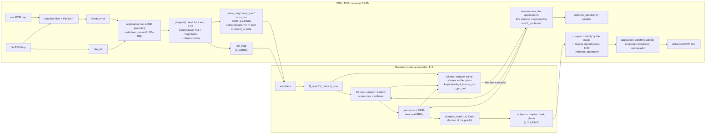

# Stateless accelerator deployment

請在模型目錄執行本頁的 Python 指令。

The accelerator graph is stateless.  The application owns every K/V,
score-convolution and GRU tensor: a float host allocates the four buffers and
registers them with the library, on a board the accelerator's own buffers hold
them and the library registers nothing.  Align-ULCNet is a postfilter, so
microphone PCM first enters the linear AEC; the learned graph consumes
`linear_error`, not raw microphone.

After the separate batch-1 cleanup (`onnx_batch1_optimizer.py`, run last on the exported file), each
convolution's frequency-axis zero padding sits in the Conv `pads` attribute (`fold_frequency_pad_into_conv`) and
no separate Pad op feeds a Conv; the temporal axis is never padded (its history is a tensor).



The production graph is fixed to `batch=1`, `T=1`, real/imaginary in the last
dimension. `D` is fixed at export time; D=4 and D=8 are different ONNX tensor
contracts even though their weight shapes are identical. The portable ABI
accepts `2 <= D <= 64`; D=1 would leave a Slice that keeps zero frames, which is
not portable across target runtimes and is therefore evaluation-only.

The fixed front end never enters the quantized domain: the host computes the
signed-power compression (`sign(x) * |x|^0.3`), both magnitudes and the
compressed-domain phase as cos/sin in fp32, and the graph binds the four
feature tensors as separate inputs so each keeps its own quantization scale.
The graph ends at the `complex_mask` 1x1 Conv and returns the learned mask
itself; the fixed back end (complex multiply of the compressed error spectrum,
which `prepare()` keeps in the model-I/O state, by that mask, then the inverse
signed power) runs on the host.
The far branch is the original raw reference. PBFDKF's aligned copy is private
to formation of the linear-error branch; the model's TA block owns alignment.

The two tables below are the graph boundary (state layout version 18), the only
one `ulcnet_model_io.h` binds.

The library knows none of the state shapes below; the application sizes its
buffers from them (`TA_BINS = (BINS + 9) / 10`, 26 at 257 bins and 52 at 513,
equal to what `ta_bins_for()` in `export_onnx.py` reads off the encoder) and
registers element counts, not bytes.

Inputs per invocation (all state tensors are rank 4):

| tensor | float32 shape | ordering |
|---|---:|---|
| `error_mag` | `[1,1,BINS]` | compressed-domain magnitude of linear error |
| `far_mag` | `[1,1,BINS]` | compressed-domain magnitude of the far branch |
| `error_cos` | `[1,1,BINS]` | cos of the compressed-domain error phase |
| `error_sin` | `[1,1,BINS]` | sin of the compressed-domain error phase |
| `key_history` | `[1,32,D,TA_BINS]` | newest first: slot 0 is t-1, slot D-1 is t-D and is never read |
| `value_history` | `[1,32,D,TA_BINS]` | newest first: slot 0 is t-1, slot D-1 is never read |
| `logit_history` | `[1,32,5,D]` | chronological: frame 0 is t-5 and is never read, frame 4 is t-1 |
| `h_gru` | `[1,4,1,128]` | NCHW; subband GRU 0 layers, then subband GRU 1 layers, stacked on dim 1 |

Outputs per invocation:

| tensor | float32 shape | CPU action |
|---|---:|---|
| `output` | `[1,2,1,BINS]` | the learned complex mask, planar (plane 0 real, plane 1 imaginary); multiply the compressed error spectrum by it, apply the inverse signed power (`sign(x) * |x|^(1/0.3)`). `ulcnet_model_io_enhance_spectrum()` does both; the application's `AcIstft` does the IFFT and overlap-add |
| `key_history_out` | `[1,32,D,TA_BINS]` | bound to the address of `key_history` |
| `value_history_out` | `[1,32,D,TA_BINS]` | bound to the address of `value_history` |
| `logit_history_out` | `[1,32,5,D]` | bound to the address of `logit_history` |
| `h_gru_out` | `[1,4,1,128]` | bound to the address of `h_gru` |

Every state tensor comes back whole with exactly its input's shape, and the
runtime binds each `*_out` to the address of the input of the same name:
`prepare()` returns `out.<state>_out == in.<state>`, fixed for the life of the
state. The runtime must finish reading every state input before it writes any
state output. There is no copy path and no ping-pong. A refused
`enhance_spectrum()` cannot roll back: the registered state tensors are zeroed
(a board registers none), the state generation advances, and a run that
reported failure is taken not to have written.

The window shift happens inside the graph, on the input side. K/V (newest
first) keep the input's slots `0..D-2` through a Slice (axis 2, step 1, end
`D-1`) and the new frame is concatenated in front; the logit window keeps
frames `1..4` (end 5) and the new row is concatenated behind. The Concat result
is the attention input and also the output, so no state output is produced by a
Slice, and the one slot a window drops only keeps the input and output shapes
equal. `export_graph` checks the written file with
`validate_inplace_state_contract` (`AIAEC/_onnx_contract.py`, a wrapper over
`validate_inplace_state_graph` in `AINR/onnx_streaming_contract.py`): identical rank-4
shapes per state pair, exactly one Slice consumer per window input, no state
output produced by a Slice, and `state_binding = in_place_same_address` in the
metadata. `query_now` is not state and is not returned. Delay distribution is
debug-only and is not part of the production ABI.

`ulcnet_model_io_state_generation()` (also exposed as
`ulcnet_prepost_state_generation()` and
`ulcnet_accelerator_adapter_state_generation()`) counts the times the C side
restarted the state: `reset` and each refused frame add one, whether or not
state is registered; it is 0 after init. A board whose accelerator keeps
fixed-point state loads the quantized representation of zero into its state
inputs at start and whenever the value differs from the one it last saw.

A board that calls the model I/O layer directly uses it in this order (error
paths fail open and must not call `enhance_spectrum` with incomplete
accelerator outputs):

```c
UlcnetGridSpec spec = { .sample_rate = 16000, .n_fft = 512, .delay_depth = 8 };
UlcnetGrid grid;
UlcnetModelIoDescriptor desc;
UlcnetModelIoMemReq req;
UlcnetModelIoInputs in;
UlcnetModelIoOutputs out;
UlcnetModelIoState *state;
uint32_t generation_seen;
void *pool;  /* board static arena address, assigned after the size query */

ulcnet_grid_make(&grid, &spec);                  /* what the graph was exported for */
ulcnet_model_io_descriptor_default(&grid, &desc);
ulcnet_model_io_get_mem_requirements(&desc, &req);
/* Assign pool to req.bytes at req.alignment in the board's static arena. */
state = ulcnet_model_io_init(pool, req.bytes, &desc, NULL);  /* NULL: the accelerator holds the state */
generation_seen = ulcnet_model_io_state_generation(state);
/* ... load the quantized zero into the accelerator's state buffers ... */

/* per hop */
if (ulcnet_model_io_state_generation(state) != generation_seen) {
    /* ... reload the quantized zero into the accelerator's state buffers ... */
    generation_seen = ulcnet_model_io_state_generation(state);
}
ulcnet_model_io_prepare(state, err_re, err_im, far_re, far_im, &in, &out);
/* Bind in.* to the accelerator inputs and every out.*_out to the address of
 * the matching in.* state (a float host registers its buffers with
 * UlcnetModelIoStateBuffers instead of NULL; prepare() returns them). The
 * runtime reads all state inputs before it writes any state output. */
if (run_accelerator(&in, &out) == 0 &&
    ulcnet_model_io_enhance_spectrum(state, enhanced_re, enhanced_im) == 0) {
    /* enhanced_re/im may now be sent to the synthesis (ac_istft_push_planar). */
} else {
    /* Output the linear-error hop. A refused enhance_spectrum() advanced the
     * state generation (the next hop's check reloads the board's state; a float
     * host's registered buffers are already zeroed); a run that was never
     * finished leaves the state as the accelerator wrote it. */
}
```

Export a true one-frame graph with:

```bash
python3 export_onnx.py \
  --checkpoint checkpoint.pth \
  --max-delay-frames 8 \
  --output output/align_ulcnet_d8_stream.onnx \
  --verify
```

Capture PTQ inputs for the same D with this model's calibration entry point.
`--primary-dir` holds `linear_error` WAVs that this build's front end
(`aiaec-linear-error-v4`, the AEC analysis seam) produced and that carry a stamp,
see "Linear-error provenance and stamps" below:

```bash
python3 inference.py calib \
  --checkpoint checkpoint.pth \
  --primary-dir /path/to/linear_error \
  --far-dir /path/to/raw_far \
  --frames 256 --max-delay-frames 8 \
  --format npz --output calib/align_ulcnet_d8.npz
```

For NPU tools that consume one raw file per input per invocation, select the
binary directory format:

```bash
python3 inference.py calib \
  --checkpoint checkpoint.pth \
  --primary-dir /path/to/linear_error \
  --far-dir /path/to/raw_far \
  --frames 8192 --max-delay-frames 8 \
  --format bin \
  --output calib/align_ulcnet_d8
```

The layout is `<tensor>/<tensor>_<frame>.bin`, with zero-based frame numbers;
for example `h_gru/h_gru_0000.bin`. Each file is C-contiguous and
little-endian. `manifest.json` records dtype and per-frame shape. The output
directory must not already exist, so a shorter rerun cannot leave stale frames.

Calibration and deployment use the same training-domain raw far signal; the
report records both fields so a disagreement is fail-fast. The
D value must match the exported graph because it fixes the K/V window tensor
shapes the application's state buffers follow, not because changing D requires
retraining.

### Linear-error provenance and stamps

The calibration tensors are recorded behind one specific front end. Stems from
the retired `aiaec-linear-error-v3` front end (or any other AEC build) hold
different statistics, so `calib` checks where a pre-made `--primary-dir` came
from. The directory must carry one of:

- `linear_error.contract.json` inside it (written by a `--primary-is-mic` run),
- a `linear_error.done.json` corpus ledger next to it that records the
  contract identity (a fingerprint-only legacy ledger is "unstamped"; a
  ledger that does not claim every chunk sequence under the directory is
  refused as a half re-rendered corpus).

The stamp must equal the checkpoint's own `linear_aec` contract. Refused, before
the ONNX graph or the artifact is written: a retired contract version or AEC
behaviour hash, a contract that differs from the checkpoint's, an internally
inconsistent stamp (its fingerprint does not match its contract), a stamp from a
seam other than `analysis_formed`, and a directory with no stamp at all
("carry no front-end stamp"). `--allow-unstamped-linear-error` waives only the
last case: it warns and the report records
`linear_error_stamp.origin = unstamped_override`. It is rejected together with
`--primary-is-mic`.

`--primary-is-mic` is the self-stamping route. Pass RAW microphone WAVs as
`--primary-dir`; the checkpoint-matched frozen PBFDKF derives the stems in
process, writes them to `<output>_linear_error/` with a
`linear_error.contract.json` made from the checkpoint's contract (written last,
so an interrupted run leaves no stamp), and the manifest records
`primary_source = raw_mic_via_frozen_pbfdkf`:

```bash
python3 inference.py calib \
  --checkpoint checkpoint.pth \
  --primary-dir /path/to/raw_mic --far-dir /path/to/raw_far \
  --primary-is-mic --frames 8192 --max-delay-frames 8 \
  --format bin --output calib/align_ulcnet_d8
```

The calibration report (`manifest.json` for BIN, `<name>.calib.json` for NPZ) is
stamped with `linear_aec_contract_version`, `aec_behavior_hash`,
`linear_aec_contract_hash`, `error_input_seam` and `linear_error_stamp`
(origin `sidecar`, `corpus_ledger`, `derived_in_process` or
`unstamped_override`). `PTQ/calib_analyze.py` refuses an artifact whose stamp is
missing, from another contract version, or retired, both on load and when
writing a pruned selection; regenerate it with `inference.py calib`. Export
and inference also refuse a checkpoint recorded under a retired behaviour hash.
`inference.py --input-is-linear-error` is an evaluation-only bypass and does not
check the supplied WAV's origin. None of these checks lives in C: the C code
never refuses a model by front-end version.

The exporter writes a sibling JSON descriptor containing the exact grid,
state layout version, `state_binding`, D, the fixed `raw_far` deployment
contract, the checkpoint's separate training provenance, and tensor schemas. Only the
model-local `export_onnx.py` is a supported user entry point.

## Graph boundary

There is one boundary and no layout switch: the fixed front and back ends run on
the host (`stream_features`, `host_back_end`; C: `ulcnet_model_io_prepare` and
`ulcnet_model_io_enhance_spectrum`), the graph binds the four feature tensors and four
rank-4 state tensors, and the two subband GRU hiddens travel as one `h_gru`.
`export_onnx.py` and `inference.py calib` take no layout flag, and
`inference.py calib` exports the graph from the same model instance in the same
process. The version is `LAYOUT_VERSION` in `export_onnx.py` and
`ULCNET_MODEL_IO_LAYOUT_VERSION` in `ulcnet_model_io.h` (both 18; a test pins
them together). Versions 3-17 are retired (`RETIRED_LAYOUT_VERSIONS`): a number
that once meant one boundary must never also mean another, because state
element counts can coincide across boundaries and nothing but the version can
tell them apart.

The layout does not identify the training front end. `export_onnx.py` copies
`linear_aec_contract_version` and `aec_behavior_hash` from the checkpoint's
`linear_aec` contract into the JSON and ONNX metadata, together with
`error_input_seam = analysis_formed` (the error input is the AEC analysis seam,
`formed_hop` / `beam.spectrum`, never the rendering base). The integrator
may compare or log `linear_aec_contract_version` against
`ULCNET_MODEL_IO_FRONTEND_CONTRACT` in `ulcnet_model_io.h`
(`aiaec-linear-error-v4`), e.g. to tell a graph exported from a retired v3
checkpoint. The C code never reads the constant and
`ulcnet_accelerator_adapter_init()` never refuses by front end. Enforcement is
on the Python side (export, inference, calibration) and in the committed
tests. The constant is not part of the descriptor and is not a layout bump; a
test pins it to `LINEAR_AEC_CONTRACT_VERSION`. Export refuses a checkpoint
without a current `linear_aec` contract.

Passing `ulcnet_model_io_descriptor_validate()` is not enough: the descriptor
holds no front-end field, so a same-shape graph from an old or custom front end
binds. The JSON sidecar also records `onnx_sha256` (the graph file's bytes,
written after the final save, so it is not one of the ONNX props), and
`frontend_gate.metadata_mismatches()` compares the sidecar with the compiled
`ULCNET_MODEL_IO_FRONTEND_CONTRACT`, the live `aec_python_behavior_hash()`, the
graph and checkpoint files and the lane grid; `frontend_gate.lane_mismatches()`
compares the deployed lane's AEC configuration with the training contract.
`tests/test_deployed_frontend_contract.py` runs both against the compiled mono
lane (see dataset_gen/README.md, "Deployment gate").

The fixed front end never enters the quantized domain: each of the four feature
inputs keeps its own quantization scale, and `sqrt`/`atan2`/`pow` stay out of
the graph.

A descriptor written for any other layout fails `ulcnet_model_io_descriptor_validate()` on
`layout_version != ULCNET_MODEL_IO_LAYOUT_VERSION`, and
`ulcnet_accelerator_adapter_init()` therefore returns NULL. The K/V and logit
windows are full windows (D and 5 frames) and the two GRU hiddens are one
tensor. The mask is a quantization target of its own: the `complex_mask` 1x1
Conv has no activation, so its range comes from calibration.

`ulcnet_model_io.c/.h` carve the feature tensors, the mask staging and the
compressed error spectrum from one caller-owned pool; its size follows the
grid, not D, and it holds no recurrent state. The state is the application's
(see "Stateless accelerator deployment"). `prepare()` NaN-fills only `output`
(the state tensors are the inputs and are not prefilled), binds each `*_out`
to its input address, computes the four feature tensors internally from the
raw spectra and keeps the compressed error spectrum in the pool.
`enhance_spectrum()` updates no state: it checks that `output` (the mask) is
finite and, when state is registered, that every element of every registered
buffer is (a non-finite value left in an older window slot would reach `output`
on a later frame), then multiplies the compressed error spectrum by the mask
and applies the inverse signed power before unpacking `enhanced_re/im`. On any
non-finite value the registered buffers are zeroed (cold start), the state
generation advances, the transaction is discarded, the caller's outputs are
untouched and -1 is returned; a partial write to state is detectable only as a
non-finite value. `ulcnet_process.h` holds the `UlcnetModel` callback, the
`UlcnetNnJob`, `ulcnet_frame_is_finite()` and the framing contract below, and
no transform code. Board NPU drivers and mono/4ch pipeline wiring are outside
this model-side deliverable.

`ulcnet_prepost.c/.h` is the pre/post *class* over the model I/O layer: one
opaque `UlcnetPrepost` that takes the error and far spectra and owns the
feature front end and the per-frame accelerator transaction, so an integrator
never composes `ulcnet_model_io` by hand. It is frequency domain only. The
application frames with audiolib as `ulcnet_process.h` states: the analysis
`AcStft` per stream from `ac_stft_config_default(&sc, grid.n_fft)` (sqrt-Hann,
`spec_scale` 1, center 0, one frame per hop from hop 0) and one `AcIstft` with
`ola = AC_OLA_ENV_NORM`, `ispec_scale` 1, whose first frame emits nothing (latency
`grid.hop`). The center-0 frame is bit-identical to the last frame per hop of
the centered schedule, which `tests/test_ulcnet_prepost_c.py` pins. The
lifecycle and per-hop sequence shared by every class are described once, in
`../README.md` ("C pre/post-processing"). Specific to this one:
`frame_bypass` is the pass-through identity because stream 0 is a residual, and
it leaves every state tensor as the accelerator wrote it (a runtime that
reported failure is taken not to have written); the pool's `build_flags_hash`
still folds D, so `_init_ex` refuses a pool recorded for another D although the
bytes are equal. The class gate is `tests/test_ulcnet_prepost_c.py`.

`ulcnet_accelerator_adapter.c/.h` is the reusable bridge from this explicit
state ABI to `UlcnetModel`; it drives a `UlcnetPrepost` instance and takes the
state registration (`UlcnetModelIoStateBuffers`, NULL on a board) at init. It
is included in `libaiaec_prepost.a` (`make -C AIAEC print-lib-path`); the mono
and four-channel applications add only their board runtime callback and
surrounding audio flow.

[返回本主題](../README.md)
