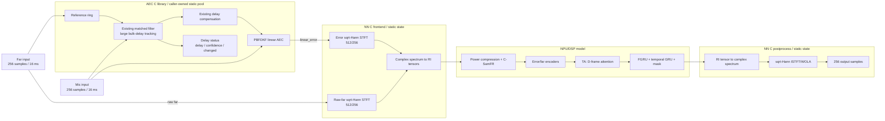
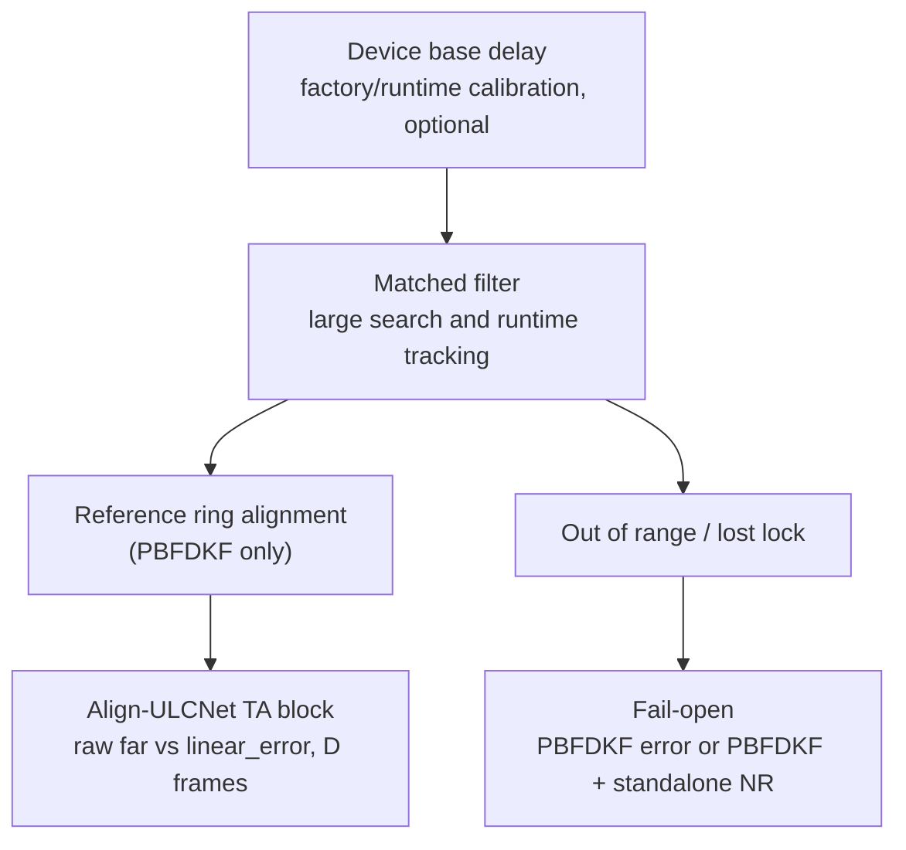

# PBFDKF + Align-ULCNet Embedded Streaming 設計

狀態：設計與實作對照。單幀 ONNX boundary（`AIAEC/Align_ULCNet/export_onnx.py`）、
CPU external-state helper（`ulcnet_model_io.c/h`、`ulcnet_accelerator_adapter.c/h`）、
C STFT/WOLA（`ulcnet_process.c/h`）與 delay 狀態機／fail-open 邏輯（[§8](align_ulcnet_embedded_streaming_design_zh_TW_01_state_wola_delay.md#8-delay-狀態機與-fallback)）都已實作，
並接入 `pipelines/ulcnet/mono_alignulcnet/` 與 `pipelines/ulcnet/4ch_alignulcnet/` 兩個 ULCNet
pipeline。state 邊界是 layout 18（`ULCNET_MODEL_IO_LAYOUT_VERSION`）：四個 rank-4
state 以完整 window 進出，每個 `*_out` 就地綁定到同名輸入的位址（[§10.2](align_ulcnet_embedded_streaming_design_zh_TW_02_npu_boundary_validation.md#102-onnx-inputoutput-contract)）。

production 的 far branch 固定讀 caller 的 raw far（與訓練及論文一致）；PBFDKF 的
aligned 副本只用來形成 linear error，對齊由模型的 TA block 負責。raw/aligned 的選擇
只存在於 `sweep_delay_depth.py`，runtime API 沒有 far-mode switch；exporter 記錄的
checkpoint 訓練 provenance 與部署契約都是 raw far。board/NPU driver 不在本專案：
`main.c` 的 `run_accelerator()` 是回 -1 的 board TODO 佔位。

**layout 18 的契約**：K/V window 是 `[1,32,D,TA]`、logit window 是 `[1,32,5,D]`，兩顆
GRU hidden 併成單一 `h_gru [1,4,1,128]`；`output` 的元素數是 2·K；
`descriptor_validate()` 另外比對 `score_window_frames`。**版本號是唯一能攔下舊板綁新圖
的閘門**：其他 layout 產出的 descriptor 在 `ulcnet_model_io_descriptor_validate()` 會卡在
`layout_version`，`ulcnet_accelerator_adapter_init()` 直接回 NULL。mask 是量化目標
（`complex_mask` 1×1 Conv 無 activation，range 由 calibration 決定）。
`ULCNET_MODEL_IO_LAYOUT_VERSION` 3–17 一律退役不得重用。

本文件供實作者評估如何將現有 PBFDKF + Align-ULCNet 路徑放到記憶體與
算力受限的 embedded system。產品測試一律使用本專案 PBFDKF 的 linear
output；論文展示頁提供的 KF residual 只作研究診斷，不是產品 frontend。

**目錄（第 6 章起已拆到 part 檔，本檔保留第 1–5 章）** <!-- split-toc -->
- [1. 目標與非目標](#1-目標與非目標) <!-- split-toc -->
  - [1.1 目標](#11-目標) <!-- split-toc -->
  - [1.2 非目標](#12-非目標) <!-- split-toc -->
  - [1.2.1 reprime 常數的推導範圍](#121-reprime-常數的推導範圍) <!-- split-toc -->
  - [1.3 48 kHz grid](#13-48-khz-grid) <!-- split-toc -->
- [2. 現況查證](#2-現況查證) <!-- split-toc -->
  - [2.1 AEC 已有的能力](#21-aec-已有的能力) <!-- split-toc -->
  - [2.2 現有 AIAEC 資料邊界](#22-現有-aiaec-資料邊界) <!-- split-toc -->
  - [2.3 D 的實際影響](#23-d-的實際影響) <!-- split-toc -->
- [3. 產品 Flow](#3-產品-flow) <!-- split-toc -->
- [4. Delay 分工](#4-delay-分工) <!-- split-toc -->
- [5. AEC 對外介面](#5-aec-對外介面) <!-- split-toc -->
  - [5.1 `AecLinearContext`](#51-aeclinearcontext) <!-- split-toc -->
  - [5.2 不共用 PBFDKF far spectrum](#52-不共用-pbfdkf-far-spectrum) <!-- split-toc -->
- [6. Streaming Model State](align_ulcnet_embedded_streaming_design_zh_TW_01_state_wola_delay.md#6-streaming-model-state) <!-- split-toc -->
  - [6.1 N 與 D 不同](align_ulcnet_embedded_streaming_design_zh_TW_01_state_wola_delay.md#61-n-與-d-不同) <!-- split-toc -->
  - [6.2 State RAM 粗估](align_ulcnet_embedded_streaming_design_zh_TW_01_state_wola_delay.md#62-state-ram-粗估) <!-- split-toc -->
  - [6.3 Attention MAC 粗估](align_ulcnet_embedded_streaming_design_zh_TW_01_state_wola_delay.md#63-attention-mac-粗估) <!-- split-toc -->
- [7. STFT/WOLA 與 Latency Contract](align_ulcnet_embedded_streaming_design_zh_TW_01_state_wola_delay.md#7-stftwola-與-latency-contract) <!-- split-toc -->
- [8. Delay 狀態機與 Fallback](align_ulcnet_embedded_streaming_design_zh_TW_01_state_wola_delay.md#8-delay-狀態機與-fallback) <!-- split-toc -->
- [9. D 的候選與 Checkpoint](align_ulcnet_embedded_streaming_design_zh_TW_01_state_wola_delay.md#9-d-的候選與-checkpoint) <!-- split-toc -->
- [10. NPU Model Boundary](align_ulcnet_embedded_streaming_design_zh_TW_02_npu_boundary_validation.md#10-npu-model-boundary) <!-- split-toc -->
  - [10.1 CPU 與 stateless model 的完整流程](align_ulcnet_embedded_streaming_design_zh_TW_02_npu_boundary_validation.md#101-cpu-與-stateless-model-的完整流程) <!-- split-toc -->
  - [10.2 ONNX input/output contract](align_ulcnet_embedded_streaming_design_zh_TW_02_npu_boundary_validation.md#102-onnx-inputoutput-contract) <!-- split-toc -->
  - [10.2.1 full-window、同位址的 state 邊界](align_ulcnet_embedded_streaming_design_zh_TW_02_npu_boundary_validation.md#1021-full-window同位址的-state-邊界) <!-- split-toc -->
  - [10.3 C 交付邊界](align_ulcnet_embedded_streaming_design_zh_TW_02_npu_boundary_validation.md#103-c-交付邊界) <!-- split-toc -->
- [11. 驗證項目](align_ulcnet_embedded_streaming_design_zh_TW_02_npu_boundary_validation.md#11-驗證項目) <!-- split-toc -->
  - [11.1 Correctness](align_ulcnet_embedded_streaming_design_zh_TW_02_npu_boundary_validation.md#111-correctness) <!-- split-toc -->
  - [11.2 場景](align_ulcnet_embedded_streaming_design_zh_TW_02_npu_boundary_validation.md#112-場景) <!-- split-toc -->
  - [11.3 指標](align_ulcnet_embedded_streaming_design_zh_TW_02_npu_boundary_validation.md#113-指標) <!-- split-toc -->
  - [11.4 板端整合確認](align_ulcnet_embedded_streaming_design_zh_TW_02_npu_boundary_validation.md#114-板端整合確認) <!-- split-toc -->
## 1. 目標與非目標

### 1.1 目標

- 固定主路徑為「本專案 matched filter + PBFDKF + Align-ULCNet」。
- 16 kHz、FFT/window/hop = `512/512/256`，每 256 samples（16 ms）處理一次。
  本文其餘各節的毫秒數、bin 數與 duty-cycle 都是這個 grid 的值；程式碼另外
  支援 48 kHz `1024/1024/512`，兩者的差異集中列在 §1.3。
- matched filter 處理設備與聲學路徑的大範圍 bulk delay。
- 模型的 TA block 在 `D` 個過去 hop 內對齊 raw far 與 linear error；`D` 是 export
  期參數（出貨訓練 config 為 32，board skeleton 範例為 8）。
- 一次只送一個新 STFT frame 給模型，但所有必要狀態跨呼叫保留。
- C frontend/postprocess 使用 caller-owned static memory；模型 inference 由
  板端 NPU/DSP runtime 執行。
- 只有 callback 失敗、partial write 或 NaN/Inf 才走 identity fail-open。

### 1.2 非目標

- 不重寫既有 AEC matched filter、delay controller 或 PBFDKF。
- 不把論文展示頁的外部 KF 當成產品品質基準。
- 不宣稱縮小 `D` 會縮小模型權重；`D` 不屬於 weight shape。
- 第一版不追求完全移除 time-alignment block。
- 第一版不改變 16 kHz signal grid，也不把模型切成互相獨立、每段重置的
  chunks。

### 1.2.1 reprime 常數的推導範圍

`REPRIME_FRAMES` 由測試量出，但**只有 far 一路是推導**：脈衝標記在 far 路
未經濾波抵達 analysis，量到的鏈記憶就是窗跨界本身，兩個 grid 都精確等於常數
（mono 1、4ch 1；4ch 的原因見 [§7](align_ulcnet_embedded_streaming_design_zh_TW_01_state_wola_delay.md#7-stftwola-與-latency-contract) 的 latency contract 與 [§8](align_ulcnet_embedded_streaming_design_zh_TW_01_state_wola_delay.md#8-delay-狀態機與-fallback) 的 direct path）。
**error 一路不是**：標記先過 AEC 線性濾波器，量到的是
跨界**加上**濾波器因果尾音，所以只能給上界。尾音長度隨 grid 變（16 kHz 的
`filter_length` 是 52 ms = 3.25 hops，48 kHz 是 64 ms = 6.00 hops），這就是
error 路在 16 kHz 與 far 路同值、在 48 kHz 多一幀的原因。等尾音消失不是
reprime 的職責，也沒有原則上的上限（照那個邏輯每個 IIR 尾音都會延長 reprime）。

### 1.3 48 kHz grid

支援的 grid 恰好兩組，且是**編譯期**選擇：C struct 內嵌 STFT/WOLA 與 scratch
buffer，一個 binary 固定一組 grid。`export_onnx.py` 的 `SUPPORTED_GRIDS` 拒絕
其他組合，`ulcnet_model_io.h` 對其他組合直接 `#error`。

| | 16 kHz | 48 kHz |
|---|---:|---:|
| `n_fft`/win/hop | `512/512/256` | `1024/1024/512` |
| K（bins） | 257 | 513 |
| C-SamFR 每通道寬 | 52 | 104 |
| attention `ta_bins` | 26 | 52 |
| hop 時長 | 16.00 ms | 10.67 ms |
| joint2 之後頻率寬 | 7 | 13 |
| subband split | (4, 3) | (7, 6) |

C 端用 `make ULCNET_GRID=16k|48k` 選 grid（底層就是那兩個 `-D`），其餘
（`HOP`/`BINS`/`TA_BINS`）全部由 `n_fft` 導出，沒有第二處需要改。`ULCNET_GRID`
只套到 ULCNet 的 TU，並折進 pipeline 的 `CFG_SIG`，所以兩個 grid 不共用 object
目錄，AEC/NR/audiolib/common 這些不含 ULCNet 程式碼的 producer 也不會跟著重建。
`make test-grids` 一次建置並測試兩個 grid。

三件跨 grid 時會咬人的事：

1. **D 不能沿用**。D 數的是 hop，而 hop 的長度不同。深度 D 往回搆到 `(D-1)`
   個 hop，所以 D=8 在 16 kHz 是 112 ms、在 48 kHz 只剩 74.7 ms；要在 48 kHz
   搆到同樣的 112 ms 需要 D=12。
2. **「由一個物理秒導出 D」在 48 kHz 不可用**。`SignalGrid.delay_frames(1.0)`
   在該 grid 給出 94，超過 `export_onnx.py` 的 `MAX_DELAY_DEPTH` 與 C 端
   `ULCNET_MODEL_IO_MAX_D` 共同的 D ≤ 64 上限。這種 run 會訓練成功、到 export
   才失敗，所以 48 kHz 必須在 `[model] max_delay_frames` 明寫 D。出貨的 16 kHz
   `config.ini` 寫的是 32，不受影響。
3. **checkpoint 不能跨 grid 沿用**。K 從 257 變 513 會改變 C-SamFR 寬度、
   `mask_fc1`/`mask_fc2` 的 `out_features` 與 attention 的 `ta_bins`，是不同的
   weight shape，必須各自訓練。

`AIAEC/aiaec_process.h` 這條**共用候選模型 API 仍固定為 16 kHz**，並以
`#if ULCNET_SR != AIAEC_SR` 的 `#error` 擋住用 48 kHz 的 Align-ULCNet 去別名它。
48 kHz 目前只有 Align-ULCNet 自己的 C pipeline 支援。

## 2. 現況查證

### 2.1 AEC 已有的能力

現有 AEC 已經具備：

- AEC3-style matched-filter delay estimator；
- reference ring 與 delay compensation；
- PBFDKF 使用 delay-compensated `far_hop`；
- 可選的 matched-filter duty cycle（`delay_est_period_s`，預設 0 = 每 hop 分析）；
- ERLE collapse watchdog；
- caller-owned static-memory API；
- `AecResContext`、`AecLinearContext` 與 `AecDebugStatus` read-only context。

因此本案不新增第二套 matched filter 或第二個 large-delay tracker。`a->far_hop`
在 delay compensation 完成後，就是該 hop 交給 PBFDKF 的 time-domain aligned
reference。

matched-filter duty cycle：`delay_est_period_s > 0` 時，delay solid 且不變約
`delay_est_init_s = 0.3 s` 後進入 duty mode，之後每 K = round(`delay_est_period_s`/hop)/5
個 hop 分析一次；delay 變動、失去 confidence 或 ERLE 比其峰值掉超過 6 dB 時恢復
full-rate analysis。reference/decimator/ring 仍每 hop 連續餵入，只有 matched-filter
analysis 降頻。預設 `delay_est_period_s = 0` 不降頻。

注意事項：

1. **grid 不是預設**：16 kHz 的 library 預設是 fft/hop = `256/128`（8 ms）；本文件
   要求的 `512/512/256` 是合法可選 grid，caller 必須顯式設定 `cfg.fft_size = 512`，
   否則 AEC hop 與 NN hop 不同拍。
2. **ERLE 相關保護在本案組態下全部有效**（C/Python 一致）。`enable_res=0 &&
   return_res_context=1`（NN seam 與 4ch pipeline 的實際組態）時：
   windowed-ERLE duty watchdog 與 `delay_acquire_protect_converged` 讀
   `last_erle_windowed`，它不論 `enable_res` 都會更新，且不進訊號路徑；
   warm tap-transfer gate 讀的 inst-ERLE ring 無條件每 hop 填充。
3. **4ch flow 的 `delay_backward_quarantine_enabled` / `_s`**（`McabConfig`，預設 OFF；lib/aec 的 `AecConfig`
   沒有這個欄位，mono 的 `Aec` 也沒有這個機制）是 `delay_acquire_protect_converged` 的 Path-B 姊妹機制，針對**已鎖定後被
   pre-echo 誤鎖搶走**。只隔離比現行 delay **更早**的共用估計，且有時間上限——到期就採用，所以是
   「延後一個窗」而不是「治癒誤鎖」。判別式是 `aec_linear_is_cancelling()`（同時看 windowed 與 inst-ERLE 兩個讀數）；
   核心只問 `capture_proxy_channel` 那一條 lane（餵給共用 estimator 的那支 mic）。4ch 產品組態維持預設 OFF；欄位語意見 `docs/integration_4ch_core_zh_TW.md` 與 `mcab.h`。

watchdog leak 依各 grid 的 hop 時間重定時，使衰減固定為 0.1 dB/s；C/Python
effective-value 與 mutation 測試鎖住此契約。

### 2.2 現有 AIAEC 資料邊界

RES+NR model view 是：

```text
linear_error = PBFDKF materialized output
far_end      = raw far_render
target       = near_target
```

PBFDKF 內部用 matched filter 對齊 reference，NN 收到的 `far_end` 則是 raw
`far_render`，由 TA block 在 `D` 個 hop 內對齊（paper-compatible Align-ULCNet 用
`D=64`）。

### 2.3 D 的實際影響

目前模型在 `D=4/8/16/32/64` 下皆為 672,441 parameters。改 `D`：

- 不改 checkpoint weight shape；
- 不需因為 load shape 而重新訓練；
- 線性改變 delay attention 的 history RAM、temporary RAM 與部分 MAC；
- 不改 encoder、CNN、FGRU、temporal GRU 與 mask head 的算量。

所以 `D=64 -> D=8` 只代表 delay-dependent attention work 約縮到 1/8，
不是整個模型變成 1/8。必須用板端 profiler 量整體改善。

- 跨 D 換載在 shape 上安全（`load_state_dict(strict=True)` 成功；D 只進
  `causal_delay_stack` 的呼叫，不進任何 `nn.*` 建構子），但輸出數值不嚴格相同：
  softmax 分母涵蓋範圍改變，且 score conv 在 delay 軸的對稱 padding（kernel 3、
  左右各補 1）零邊界會隨 D 移動。訓練後 distribution 若集中在 `d >= 8`，截斷即是
  實質行為改變，所以改 D 後必須重新評估品質。
- `inference.py`、`sweep_delay_depth.py` 與單幀 ONNX exporter 都有 explicit
  `max_delay_frames` deployment override。D 固定在輸出的 graph/descriptor tensor
  shape；可載入同一組 D-agnostic weights 不代表 small-D 品質已放行。

## 3. 產品 Flow



每 hop 的順序必須固定：

1. 收到 `mic[256]`、`far[256]`；
2. raw far 寫進現有 reference ring；
3. 現有 matched filter 按目前 state/duty policy 更新 delay；
4. 由現有 ring 讀出該 hop 的 `aligned_far[256]`（只給 PBFDKF）；
5. PBFDKF 使用 `aligned_far`，產生 `linear_error[256]`；
6. `linear_error` 與 raw far 分別進入自己的 stateful sqrt-Hann STFT；
7. 一個新 spectral frame 與 persistent NN states 送入 NPU；
8. enhanced spectrum 經 stateful ISTFT/WOLA；
9. 輸出 256 samples。

## 4. Delay 分工



- 設備已知 delay 只作 initial estimate，不取代 runtime matched filter。
- matched filter 處理 driver/buffer/acoustic-path 的 bulk delay，讓 PBFDKF 收斂；
  bank 大小 `n` 決定可靠搜尋上界（約 125 / 221 / 317 / 413 / 509 ms，n = 1..5）。
- 模型的 TA block 在 `D` 個過去 hop 內對齊 raw far 與 linear error。`n` 與 `D` 是
  兩個獨立的預算，不是同一個 delay budget。
- attention 只搜尋 current/past far（offset `d >= 0`）。
- 超出 matched search 的偏移無法被偵測：狀態停在 `UNLOCKED`，與冷啟動不可區分
  （見 §5.1、[§8](align_ulcnet_embedded_streaming_design_zh_TW_01_state_wola_delay.md#8-delay-狀態機與-fallback)）。

## 5. AEC 對外介面

### 5.1 `AecLinearContext`

`aec_get_linear_context()` 提供 read-only view：

```c
typedef enum AecLinearDelayState {
    AEC_LINEAR_DELAY_UNLOCKED = 0,
    AEC_LINEAR_DELAY_LOCKED,
    AEC_LINEAR_DELAY_CHANGED
} AecLinearDelayState;

typedef struct AecLinearContext {
    int hop_size;
    const float *formed_linear_hop;
    const float *aligned_far_hop;
    int delay_samples;
    float delay_confidence;
    AecLinearDelayState delay_state;
    unsigned int generation;
} AecLinearContext;

void aec_get_linear_context(const Aec *aec, AecLinearContext *context);
```

介面 contract：

- `aligned_far_hop` alias 該次 PBFDKF 真正讀取的 `a->far_hop`；
- 不配置新 heap，不複製一份 hop；
- pointer 只在下一次 process/reset 前有效；
- reset、first acquisition 與 delay shift 都更新 `generation`（saturating）；
- getter 不改任何 AEC state。

enum 刻意不含 `OUT_OF_RANGE`：超出搜尋範圍在現有 estimator 下與「未鎖定」不可區分，
只回 `UNLOCKED`。此時模型照常執行並套用；`delay_state` 只供診斷與 alignment 切換
reset，不閘控模型。

| 欄位 | 內容 |
|---|---|
| `formed_linear_hop` | alias formed linear-error hop |
| `aligned_far_hop` | alias PBFDKF 本 hop 實際消費的 far；UNLOCKED 時為 raw far。pipeline 不拿它餵模型 |
| `delay_samples` | 已套用的 ring offset；MATCHED 尚未 acquire 時為 `-1` |
| `delay_confidence` | 與 `AecDebugStatus` 同源的 0/0.5/1 confidence |
| `delay_state` | `UNLOCKED/LOCKED/CHANGED`；不區分 out-of-range 與尚未鎖定 |
| `generation` | reset、first acquisition、soft/hard shift 均遞增並飽和；外部用於清除跨 hop cache |

### 5.2 不共用 PBFDKF far spectrum

`AecResContext.far_spec` 是 PBFDKF frontend 的頻譜，NN frontend 的 contract 是
periodic sqrt-Hann、512/256、50% overlap。兩者不同：`far_spec` 是無 analysis window
的矩形 overlap-save rFFT，sqrt-Hann 只用在 near/error 側。窗形不同，不可直接共用；
模型的 far 分支對 raw far 做自己的 stateful STFT。

