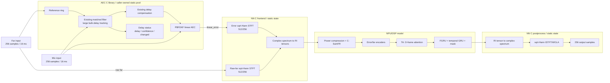
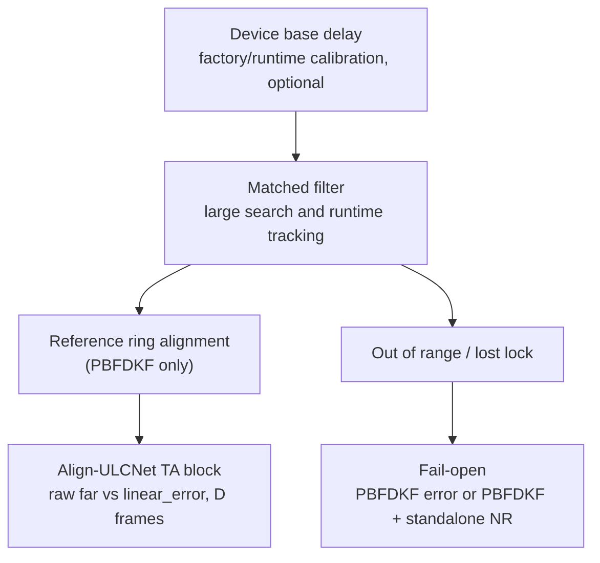
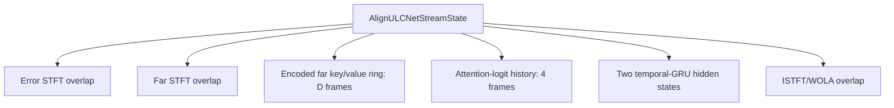

# PBFDKF + Align-ULCNet Embedded Streaming 設計

狀態：設計與實作對照。單幀 ONNX boundary（`AIAEC/Align_ULCNet/export_onnx.py`）、
CPU external-state helper（`ulcnet_model_io.c/h`、`ulcnet_accelerator_adapter.c/h`）、
C STFT/WOLA（`ulcnet_process.c/h`）與 delay 狀態機／fail-open 邏輯（§8）都已實作，
並接入 `pipelines/mono_alignulcnet/` 與 `pipelines/4ch_alignulcnet/` 兩個 ULCNet
pipeline。state 邊界是 layout 18（`ULCNET_MODEL_IO_LAYOUT_VERSION`）：四個 rank-4
state 以完整 window 進出，每個 `*_out` 就地綁定到同名輸入的位址（§10.2）。

production 的 far branch 固定讀 caller 的 raw far（與訓練及論文一致）；PBFDKF 的
aligned 副本只用來形成 linear error，對齊由模型的 TA block 負責。raw/aligned 的選擇
只存在於 `sweep_delay_depth.py`，runtime API 沒有 far-mode switch；exporter 記錄的
checkpoint 訓練 provenance 與部署契約都是 raw far。board/NPU driver 不在本專案：
`main.c` 的 `run_accelerator()` 是回 -1 的 board TODO 佔位。

**layout 18 的契約**：K/V window 是 `[1,32,D,TA]`、logit window 是 `[1,32,5,D]`，兩顆
GRU hidden 併成單一 `h_gru [1,4,1,128]`；`output` 的元素數是 2·K；
`descriptor_validate()` 另外比對 `score_window_frames`。**版本號是唯一能攔下舊板綁新圖
的閘門**：其他 layout 產出的 descriptor 在 `ulcnet_model_io_descriptor_validate()` 會卡在
`layout_version`，`ulcnet_accelerator_adapter_init()` 直接回 NULL。mask 是量化目標
（`complex_mask` 1×1 Conv 無 activation，range 由 calibration 決定）。
`ULCNET_MODEL_IO_LAYOUT_VERSION` 3–17 一律退役不得重用。

本文件供實作者評估如何將現有 PBFDKF + Align-ULCNet 路徑放到記憶體與
算力受限的 embedded system。產品測試一律使用本專案 PBFDKF 的 linear
output；論文展示頁提供的 KF residual 只作研究診斷，不是產品 frontend。

## 1. 目標與非目標

### 1.1 目標

- 固定主路徑為「本專案 matched filter + PBFDKF + Align-ULCNet」。
- 16 kHz、FFT/window/hop = `512/512/256`，每 256 samples（16 ms）處理一次。
  本文其餘各節的毫秒數、bin 數與 duty-cycle 都是這個 grid 的值；程式碼另外
  支援 48 kHz `1024/1024/512`，兩者的差異集中列在 §1.3。
- matched filter 處理設備與聲學路徑的大範圍 bulk delay。
- 模型的 TA block 在 `D` 個過去 hop 內對齊 raw far 與 linear error；`D` 是 export
  期參數（出貨訓練 config 為 32，board skeleton 範例為 8）。
- 一次只送一個新 STFT frame 給模型，但所有必要狀態跨呼叫保留。
- C frontend/postprocess 使用 caller-owned static memory；模型 inference 由
  板端 NPU/DSP runtime 執行。
- 只有 callback 失敗、partial write 或 NaN/Inf 才走 identity fail-open。

### 1.2 非目標

- 不重寫既有 AEC matched filter、delay controller 或 PBFDKF。
- 不把論文展示頁的外部 KF 當成產品品質基準。
- 不宣稱縮小 `D` 會縮小模型權重；`D` 不屬於 weight shape。
- 第一版不追求完全移除 time-alignment block。
- 第一版不改變 16 kHz signal grid，也不把模型切成互相獨立、每段重置的
  chunks。

### 1.2.1 reprime 常數的推導範圍

`REPRIME_FRAMES` 由測試量出，但**只有 far 一路是推導**：脈衝標記在 far 路
未經濾波抵達 analysis，量到的鏈記憶就是窗跨界本身，兩個 grid 都精確等於常數
（mono 1、4ch 1；4ch 的原因見 §7 的 latency contract 與 §8 的 direct path）。
**error 一路不是**：標記先過 AEC 線性濾波器，量到的是
跨界**加上**濾波器因果尾音，所以只能給上界。尾音長度隨 grid 變（16 kHz 的
`filter_length` 是 52 ms = 3.25 hops，48 kHz 是 64 ms = 6.00 hops），這就是
error 路在 16 kHz 與 far 路同值、在 48 kHz 多一幀的原因。等尾音消失不是
reprime 的職責，也沒有原則上的上限（照那個邏輯每個 IIR 尾音都會延長 reprime）。

### 1.3 48 kHz grid

支援的 grid 恰好兩組，且是**編譯期**選擇：C struct 內嵌 STFT/WOLA 與 scratch
buffer，一個 binary 固定一組 grid。`export_onnx.py` 的 `SUPPORTED_GRIDS` 拒絕
其他組合，`ulcnet_model_io.h` 對其他組合直接 `#error`。

| | 16 kHz | 48 kHz |
|---|---:|---:|
| `n_fft`/win/hop | `512/512/256` | `1024/1024/512` |
| K（bins） | 257 | 513 |
| C-SamFR 每通道寬 | 52 | 104 |
| attention `ta_bins` | 26 | 52 |
| hop 時長 | 16.00 ms | 10.67 ms |
| joint2 之後頻率寬 | 7 | 13 |
| subband split | (4, 3) | (7, 6) |

C 端用 `make ULCNET_GRID=16k|48k` 選 grid（底層就是那兩個 `-D`），其餘
（`HOP`/`BINS`/`TA_BINS`）全部由 `n_fft` 導出，沒有第二處需要改。`ULCNET_GRID`
只套到 ULCNet 的 TU，並折進 pipeline 的 `CFG_SIG`，所以兩個 grid 不共用 object
目錄，AEC/NR/audiolib/common 這些不含 ULCNet 程式碼的 producer 也不會跟著重建。
`make test-grids` 一次建置並測試兩個 grid。

三件跨 grid 時會咬人的事：

1. **D 不能沿用**。D 數的是 hop，而 hop 的長度不同。深度 D 往回搆到 `(D-1)`
   個 hop，所以 D=8 在 16 kHz 是 112 ms、在 48 kHz 只剩 74.7 ms；要在 48 kHz
   搆到同樣的 112 ms 需要 D=12。
2. **「由一個物理秒導出 D」在 48 kHz 不可用**。`SignalGrid.delay_frames(1.0)`
   在該 grid 給出 94，超過 `export_onnx.py` 的 `MAX_DELAY_DEPTH` 與 C 端
   `ULCNET_MODEL_IO_MAX_D` 共同的 D ≤ 64 上限。這種 run 會訓練成功、到 export
   才失敗，所以 48 kHz 必須在 `[model] max_delay_frames` 明寫 D。出貨的 16 kHz
   `config.ini` 寫的是 32，不受影響。
3. **checkpoint 不能跨 grid 沿用**。K 從 257 變 513 會改變 C-SamFR 寬度、
   `mask_fc1`/`mask_fc2` 的 `out_features` 與 attention 的 `ta_bins`，是不同的
   weight shape，必須各自訓練。

`AIAEC/aiaec_process.h` 這條**共用候選模型 API 仍固定為 16 kHz**，並以
`#if ULCNET_SR != AIAEC_SR` 的 `#error` 擋住用 48 kHz 的 Align-ULCNet 去別名它。
48 kHz 目前只有 Align-ULCNet 自己的 C pipeline 支援。

## 2. 現況查證

### 2.1 AEC 已有的能力

現有 AEC 已經具備：

- AEC3-style matched-filter delay estimator；
- reference ring 與 delay compensation；
- PBFDKF 使用 delay-compensated `far_hop`；
- 可選的 matched-filter duty cycle（`delay_est_period_s`，預設 0 = 每 hop 分析）；
- ERLE collapse watchdog；
- caller-owned static-memory API；
- `AecResContext`、`AecLinearContext` 與 `AecDebugStatus` read-only context。

因此本案不新增第二套 matched filter 或第二個 large-delay tracker。`a->far_hop`
在 delay compensation 完成後，就是該 hop 交給 PBFDKF 的 time-domain aligned
reference。

matched-filter duty cycle：`delay_est_period_s > 0` 時，delay solid 且不變約
`delay_est_init_s = 0.3 s` 後進入 duty mode，之後每 K = round(`delay_est_period_s`/hop)/5
個 hop 分析一次；delay 變動、失去 confidence 或 ERLE 比其峰值掉超過 6 dB 時恢復
full-rate analysis。reference/decimator/ring 仍每 hop 連續餵入，只有 matched-filter
analysis 降頻。預設 `delay_est_period_s = 0` 不降頻。

注意事項：

1. **grid 不是預設**：16 kHz 的 library 預設是 fft/hop = `256/128`（8 ms）；本文件
   要求的 `512/512/256` 是合法可選 grid，caller 必須顯式設定 `cfg.fft_size = 512`，
   否則 AEC hop 與 NN hop 不同拍。
2. **ERLE 相關保護在本案組態下全部有效**（C/Python 一致）。`enable_res=0 &&
   return_res_context=1`（NN seam 與 4ch pipeline 的實際組態）時：
   windowed-ERLE duty watchdog 與 `delay_acquire_protect_converged` 讀
   `last_erle_windowed`，它不論 `enable_res` 都會更新，且不進訊號路徑；
   warm tap-transfer gate 讀的 inst-ERLE ring 無條件每 hop 填充。
3. **`delay_backward_quarantine_enabled` / `_s`**（預設 OFF，見
   `lib/aec/docs/c_user_manual_zh_TW.md` 與
   `lib/aec/docs/delay_estimator_design_zh_TW.md`）是
   `delay_acquire_protect_converged` 的 Path-B 姊妹機制，針對**已鎖定後被 pre-echo
   誤鎖搶走**。只隔離比現行 delay **更早**的候選，且有時間上限——到期就採用，所以是
   「延後一個窗」而不是「治癒誤鎖」。判別式 `aec_linear_is_cancelling()` 同時看
   windowed 與 inst-ERLE 兩個讀數，兩端共用同一函式；4ch core 只問
   `capture_proxy_channel` 那一條 lane（餵給共用 estimator 的那支 mic）。產品組態與
   AIAEC 的 frozen frontend 都維持預設 OFF。

watchdog leak 依各 grid 的 hop 時間重定時，使衰減固定為 0.1 dB/s；C/Python
effective-value 與 mutation 測試鎖住此契約。

### 2.2 現有 AIAEC 資料邊界

RES+NR model view 是：

```text
linear_error = PBFDKF materialized output
far_end      = raw far_render
target       = near_target
```

PBFDKF 內部用 matched filter 對齊 reference，NN 收到的 `far_end` 則是 raw
`far_render`，由 TA block 在 `D` 個 hop 內對齊（paper-compatible Align-ULCNet 用
`D=64`）。

### 2.3 D 的實際影響

目前模型在 `D=4/8/16/32/64` 下皆為 672,441 parameters。改 `D`：

- 不改 checkpoint weight shape；
- 不需因為 load shape 而重新訓練；
- 線性改變 delay attention 的 history RAM、temporary RAM 與部分 MAC；
- 不改 encoder、CNN、FGRU、temporal GRU 與 mask head 的算量。

所以 `D=64 -> D=8` 只代表 delay-dependent attention work 約縮到 1/8，
不是整個模型變成 1/8。必須用板端 profiler 量整體改善。

- 跨 D 換載在 shape 上安全（`load_state_dict(strict=True)` 成功；D 只進
  `causal_delay_stack` 的呼叫，不進任何 `nn.*` 建構子），但輸出數值不嚴格相同：
  softmax 分母涵蓋範圍改變，且 score conv 在 delay 軸的對稱 padding（kernel 3、
  左右各補 1）零邊界會隨 D 移動。訓練後 distribution 若集中在 `d >= 8`，截斷即是
  實質行為改變，所以改 D 後必須重新評估品質。
- `inference.py`、`sweep_delay_depth.py` 與單幀 ONNX exporter 都有 explicit
  `max_delay_frames` deployment override。D 固定在輸出的 graph/descriptor tensor
  shape；可載入同一組 D-agnostic weights 不代表 small-D 品質已放行。

## 3. 產品 Flow



每 hop 的順序必須固定：

1. 收到 `mic[256]`、`far[256]`；
2. raw far 寫進現有 reference ring；
3. 現有 matched filter 按目前 state/duty policy 更新 delay；
4. 由現有 ring 讀出該 hop 的 `aligned_far[256]`（只給 PBFDKF）；
5. PBFDKF 使用 `aligned_far`，產生 `linear_error[256]`；
6. `linear_error` 與 raw far 分別進入自己的 stateful sqrt-Hann STFT；
7. 一個新 spectral frame 與 persistent NN states 送入 NPU；
8. enhanced spectrum 經 stateful ISTFT/WOLA；
9. 輸出 256 samples。

## 4. Delay 分工



- 設備已知 delay 只作 initial estimate，不取代 runtime matched filter。
- matched filter 處理 driver/buffer/acoustic-path 的 bulk delay，讓 PBFDKF 收斂；
  bank 大小 `n` 決定可靠搜尋上界（約 125 / 221 / 317 / 413 / 509 ms，n = 1..5）。
- 模型的 TA block 在 `D` 個過去 hop 內對齊 raw far 與 linear error。`n` 與 `D` 是
  兩個獨立的預算，不是同一個 delay budget。
- attention 只搜尋 current/past far（offset `d >= 0`）。
- 超出 matched search 的偏移無法被偵測：狀態停在 `UNLOCKED`，與冷啟動不可區分
  （見 §5.1、§8）。

## 5. AEC 對外介面

### 5.1 `AecLinearContext`

`aec_get_linear_context()` 提供 read-only view：

```c
typedef enum AecLinearDelayState {
    AEC_LINEAR_DELAY_UNLOCKED = 0,
    AEC_LINEAR_DELAY_LOCKED,
    AEC_LINEAR_DELAY_CHANGED
} AecLinearDelayState;

typedef struct AecLinearContext {
    int hop_size;
    const float *formed_linear_hop;
    const float *aligned_far_hop;
    int delay_samples;
    float delay_confidence;
    AecLinearDelayState delay_state;
    unsigned int generation;
} AecLinearContext;

void aec_get_linear_context(const Aec *aec, AecLinearContext *context);
```

介面 contract：

- `aligned_far_hop` alias 該次 PBFDKF 真正讀取的 `a->far_hop`；
- 不配置新 heap，不複製一份 hop；
- pointer 只在下一次 process/reset 前有效；
- reset、first acquisition 與 delay shift 都更新 `generation`（saturating）；
- getter 不改任何 AEC state。

enum 刻意不含 `OUT_OF_RANGE`：超出搜尋範圍在現有 estimator 下與「未鎖定」不可區分，
只回 `UNLOCKED`。此時模型照常執行並套用；`delay_state` 只供診斷與 alignment 切換
reset，不閘控模型。

| 欄位 | 內容 |
|---|---|
| `formed_linear_hop` | alias formed linear-error hop |
| `aligned_far_hop` | alias PBFDKF 本 hop 實際消費的 far；UNLOCKED 時為 raw far。pipeline 不拿它餵模型 |
| `delay_samples` | 已套用的 ring offset；MATCHED 尚未 acquire 時為 `-1` |
| `delay_confidence` | 與 `AecDebugStatus` 同源的 0/0.5/1 confidence |
| `delay_state` | `UNLOCKED/LOCKED/CHANGED`；不區分 out-of-range 與尚未鎖定 |
| `generation` | reset、first acquisition、soft/hard shift 均遞增並飽和；外部用於清除跨 hop cache |

### 5.2 不共用 PBFDKF far spectrum

`AecResContext.far_spec` 是 PBFDKF frontend 的頻譜，NN frontend 的 contract 是
periodic sqrt-Hann、512/256、50% overlap。兩者不同：`far_spec` 是無 analysis window
的矩形 overlap-save rFFT，sqrt-Hann 只用在 near/error 側。窗形不同，不可直接共用；
模型的 far 分支對 raw far 做自己的 stateful STFT。

## 6. Streaming Model State

真正 streaming 是每次輸入少量新資料、但歷史 state 持續存在；不是把完整
forward 切成多個互相獨立的 N-frame chunks。



目前層級的時間狀態判定：

| 模組 | 跨時間 state |
|---|---|
| C-SamFR、stream encoders | 無；time kernel = 1 |
| JointConv blocks | 無；time kernel = 1 |
| Q/K/V projection | 無；1x1 |
| Delay candidate | encoded far key/value ring，長度 D |
| Attention score conv | 需前 4 frames；time kernel = 5（全模型唯一 time kernel > 1 的層） |
| FGRU | 沿 frequency 運行，每個 time frame 獨立；⚠ bidirectional over frequency，版端每 frame 要跑正反兩個方向 |
| Two subband temporal GRUs | 必須保存每層 hidden state |
| Stage-2 mask conv | 無；time kernel = 1 |
| STFT/ISTFT | overlap/window state |
| BatchNorm2d（×6） | 無跨時間 state，但 train 模式對時間軸取統計——streaming 等價的唯一數學風險。必須 `eval()` 並 fold 進 conv（實測 train 模式 prefix 差 0.44、eval 模式差 5.6e-9） |

### 6.1 N 與 D 不同

- `N`：一次 NPU invocation 輸入幾個新 frames；可為 1、2、4 或 8。
- `D`：persistent far history 的 delay search span。

`N=1` 不代表 `D=1`。出貨 pipeline 是 `N=1`；若版端 batching
效率需要 `N=2/4`，states 仍必須跨 invocation 保留。

### 6.2 State RAM 粗估

16 kHz、512/256、float32、encoder width 26、32 key/value channels。state 以
完整 window 進出：K/V 各保存 D 幀（newest-first），logit 保存 5 幀（score conv
的 5 幀輸入，oldest-first），兩顆 2-layer temporal-GRU hidden 併成一個
`[1,4,1,128]`。graph 取輸入 window 的前 D-1 幀（logit 取後 4 幀）再接上新的
一幀，所以輸入與輸出 shape 相同；被丟掉的那一格只讓 shape 相等。Python
`DelayRingCell` 保存的就是同一個 D 幀 ring。

| State | D=8（16 kHz） |
|---|---:|
| encoded far key window | 26.0 KiB（8 幀） |
| encoded far value window | 26.0 KiB（8 幀） |
| attention-logit window（5 frames） | 5.0 KiB |
| 兩顆 2-layer temporal-GRU hidden（合併的 `h_gru`） | 2.0 KiB |
| STFT/WOLA overlap | 數 KiB |

NN persistent state 約 59.0 KiB（四個 state tensor 各一份 buffer，每個 `*_out`
就地綁定到輸入位址）；另加 STFT/WOLA 數 KiB。
GRU hidden = 2 blocks × 2 layers × 128 × 4 B = 2.0 KiB，GRU 無
cell state。上述不含 model weights、NPU activation scratch 與 backend alignment。
D=4 可再降低 key/value ring 與 logit window；最終數字必須由 export
後的 tensor layout 與板端 allocator 報告。

48 kHz 的 `ta_bins` 加倍（26 → 52），key/value window 跟著加倍，但
logit window 只隨 D 走、不隨 grid 走，所以整體不是兩倍。

adapter 驅動的是 `ulcnet_prepost` class 的一個 `ULCNET_IO_FREQ` 實例（頻譜進、
頻譜出、不做 transform），所以 adapter pool ＝ class 的 FREQ pool ＋ 32 B 的
adapter 自身結構，比只包 model_io 的 pool 多一個 class 前後處理 scratch。實測
`ulcnet_accelerator_adapter_get_mem_size()`（四個 state、特徵輸入與 `output`
staging、工作區）：

| adapter pool | D=4 | D=8 | D=16 | D=32 | D=64 |
|---|---:|---:|---:|---:|---:|
| 16 kHz（TA=26） | 46,096 B | 75,280 B | 133,648 B | 250,384 B | 483,856 B |
| 48 kHz（TA=52） | 87,056 B | 142,864 B | 254,480 B | 477,712 B | 924,176 B |

只要 model_io 的 K/V／logit／GRU state（`ulcnet_model_io_get_mem_requirements()`，
不含 class 的前後處理 scratch）：

| model_io pool | D=4 | D=8 | D=16 | D=32 | D=64 |
|---|---:|---:|---:|---:|---:|
| 16 kHz（TA=26） | 39,696 B | 68,880 B | 127,248 B | 243,984 B | 477,456 B |
| 48 kHz（TA=52） | 74,512 B | 130,320 B | 241,936 B | 465,168 B | 911,632 B |

adapter 與 model_io 的差額（16 kHz D=8：6,416 B）是 class 的前後處理 scratch。

過邊界的 persistent tensor 小計（不含特徵輸入／`output` staging 與工作區）：16 kHz D=8 為
59.00 KiB、48 kHz D=8 為 111.00 KiB；D=64 則是 458.00 KiB 與 874.00 KiB。

### 6.3 Attention MAC 粗估

只計 delay-dependent dot/weighted-sum/score 部分，約隨 D 線性：

```text
D=8  : 約 1.1 M MAC/s
D=64 : 約 8.6 M MAC/s
```

這不包含 Q/K/V、encoders、FGRU、temporal GRUs 與 mask head。必須同時量：

- 整體 cycles/hop；
- attention cycles/hop；
- NPU scratch peak；
- end-to-end 16 ms deadline margin。

## 7. STFT/WOLA 與 Latency Contract

Python offline feature path 使用 `center=True`。Embedded streaming 不可每個 chunk
各自呼叫 centered STFT；C 端建立持續的 analysis/synthesis buffers（audiolib 的
`AcStft`／`AcIstft`，`center` 0 的 rolling 分析）：

- periodic sqrt-Hann；
- FFT/window/hop = 512/512/256；
- error 與 far 使用同一 frame timestamp；
- synthesis 為對應的 50% overlap WOLA；
- 對外 latency 以 samples 實測記錄，不只由公式推測。

在本 grid（win=n_fft、hop=win/2、同一 sqrt-Hann 窗）下，centered 第 k 幀與
non-centered 第 k-1 幀覆蓋**完全相同的樣本**（逐 bit 同頻譜）——兩種 framing 的
穩態特徵相同，且 STFT→NN→ISTFT 鏈的穩態 I/O 延遲都是同一個 1 hop（16 ms，WOLA
收尾本來就要等下一幀）。所以 center 是**邊界與編號慣例**：真實差異只有
(a) 串流開頭第一幀（reflect 前綴 vs 冷啟動）造成的 recurrent-state start transient、
(b) 檔案級評測的幀數/邊界、(c) 幀時間戳語意。要真正壓延遲屬重訓等級手段
（非對稱窗、縮 hop）。

**4ch 的 latency contract**：4ch Align-ULCNet pipeline 的「加總後額外演算法延遲」是
**1 hop**（16 kHz 256 samples = 16 ms、48 kHz 512 samples = 10.67 ms），與 mono
範例（`pipelines/mono_alignulcnet/main.c`）相同。GSC 產出的 beamformed error **頻譜**直接餵給模型（它已經是本 hop 的
sqrt-Hann 50%-overlap 單幀），中間沒有 beam WOLA→再 analysis 的來回，far 路也沒有
one-hop 補償 buffer；唯一的延遲來源就是本節的 ULCNet synthesis WOLA。`process()`
只有 hop #0 輸出零，之後 hop p 的輸出是 input hop p-1 的 beamformed error。每個 hop
從 hop #0 起都恰好一次 inference。

## 8. Delay 狀態機與 Fallback

兩個 pipeline 範例（`pipelines/mono_alignulcnet/main.c` 與
`pipelines/4ch_alignulcnet/main.c`，共用 `pipelines/samples/ulcnet_nn_stage.{h,c}`）的行為一致：

- UNLOCKED：模型照常步進並套用成功輸出（far 本來就是 raw far）；
- delay_state 變為 CHANGED，或 FIXED 首次 UNLOCKED→LOCKED：`model->reset` 清除 far
  key/value ring、attention-logit history 與兩組 temporal GRU hidden，並 arm
  identity reprime；
- infer 失敗或輸出含非有限值（NaN/Inf）：該 frame 走 identity，永不進 WOLA；
- out-of-range 偵測不存在：超出可靠搜尋上界時狀態停在 UNLOCKED，與冷啟動不可區分。

identity reprime：邊界的 `model->reset` 之後，C 側 STFT 狀態仍連續，緊接著發射的幀其
512 樣本分析窗**跨在邊界上**（一半是切換前推入的 hop）。這些幀走 identity 且**完全
不呼叫 infer**（K/V、logit、GRU 都不前進），等 err 與 far 兩路窗都只含切換後的 hop 才
同時恢復 step 與 apply：mono 與 4ch 共用 `ULCNET_NN_STAGE_REPRIME_FRAMES=1`。這個常數由
`mono_alignulcnet/tests/test_mono_ulcnet.c` 與 `4ch_alignulcnet/tests/test_4ch_ulcnet.c` 的
`test_reprime_straddle_derivation()` 以脈衝標記在**無邊界對照跑**中量出並斷言，不是
寫死的估計值。

**4ch direct path**：GSC 的 beamformed error **頻譜**直接當成模型的 error frame（它本來
就是本 hop 的 sqrt-Hann 50%-overlap 單幀），far 路用同一個 hop 的
`ac_stft_push_planar()`（`center` 0 的 `AcStft`），中間沒有 beam WOLA、沒有 error 路的
二次 analysis，也沒有 one-hop far buffer。兩路因此都從**當前** input hop 成幀，跨界幀
只剩邊界 hop 那一幀。邊界處理只做 `model->reset` ＋ arm reprime，不清任何 buffer
（C 側成幀狀態一路連續）。

**mono 的 rolling push**：mono 範例（`mono_alignulcnet/main.c` 經 `samples/ulcnet_nn_stage`）的兩路 analysis 用 rolling center=False 的
`AcStft`（`ac_stft_push_planar()`）（自 hop#0 起每 hop 恰一幀、每 hop 至多一次推論），
排程與 AEC/GSC seam 一致。reprime 每 hop 遞減（與每發射幀遞減相等），1 hop 端到端
延遲來自 synthesis 半窗 trim，幀 scratch 為 1 幀。

兩個變體的 production far branch 固定讀 caller 的 raw far，沒有 runtime mode；
export descriptor 固定記 RAW，`ulcnet_model_io.c` 的 validate 拒絕其他值。

⚠ **短延遲部署注意**：echo path 的 bulk delay 很小（linear filter 的 832-tap 涵蓋範圍內）
時，filter 未對齊就能收斂 → ERLE 超過 2.5 dB → Path-A already-cancelling 保護
（`delay_acquire_protect_converged`，Python/C 一致）會**永久擋下 first acquisition**，
`delay_state` 恆為 UNLOCKED。這不會停用 NN：模型能否處理該偏移由 D 決定。

## 9. D 的候選與 Checkpoint

16 kHz、hop=256 時：

| D | causal candidate | 最大 past offset |
|---:|---:|---:|
| 4 | 0--3 frames | 48 ms |
| 8 | 0--7 frames | 112 ms |
| 16 | 0--15 frames | 240 ms |
| 64 | 0--63 frames | 1008 ms |

縮小 D 不改 weight shape，但 export graph 的 shape 與 state pool 必須重產；
inference/export contract 必須記錄實際 D，不可靜默覆寫。

## 10. NPU Model Boundary

產品邊界假設加速器完全 **stateless**：加速器不保存 K/V ring、
score history 或 GRU hidden。這些都是 CPU 管理的 caller-owned
static memory，每幀以普通 tensor input/output 傳給 graph。「NPU runtime
保存 state」在本文一律是指 CPU/driver context 保存，不表示模型
或加速器有隱藏 persistent state。

Align-ULCNet 是 PBFDKF 後的 RES+NR model；原始 `mic` 只進 CPU
線性 AEC，模型的 primary input 是 `linear_error`，不是 raw mic。

### 10.1 CPU 與 stateless model 的完整流程

```mermaid
flowchart LR
    subgraph CPU["CPU / DSP / external SRAM"]
        MIC["mic PCM hop"]
        FAR["far PCM hop"]
        AEC["Matched filter + PBFDKF"]
        ERR["linear_error PCM"]
        AFAR["raw far PCM"]
        ESTFT["sqrt-Hann STFT<br/>512 / 256"]
        FSTFT["sqrt-Hann STFT<br/>512 / 256"]
        FEAT["固定前端 fp32<br/>signed pow(0.3) + magnitude<br/>+ 壓縮域相位 cos/sin"]
        ERRI["error_mag / error_cos / error_sin<br/>各 [1,1,K]<br/>壓縮域 error RI 留在 model_io state"]
        FARRI["far_mag<br/>[1,1,K]"]
        KH["key_history<br/>[1,32,D,TA]<br/>caller pool；*_out 就地綁定"]
        VH["value_history<br/>[1,32,D,TA]<br/>caller pool；*_out 就地綁定"]
        LH["logit_history<br/>[1,32,5,D]<br/>caller pool；*_out 就地綁定"]
        GH["h_gru<br/>[1,4,1,128]<br/>caller pool；*_out 就地綁定"]
        CHECK["commit()：驗證 state"]
        INV["commit()：壓縮域 error × mask<br/>＋逆冪 fp32"]
        WOLA["WOLA / IFFT"]
        PCM["enhanced PCM hop"]

        MIC --> AEC
        FAR --> AEC
        AEC --> ERR --> ESTFT --> FEAT
        FAR --> AFAR --> FSTFT --> FEAT
        FEAT --> ERRI
        FEAT --> FARRI
        KH --> CHECK
        VH --> CHECK
        LH --> CHECK
        INV --> WOLA --> PCM
    end

    subgraph NPU["Stateless accelerator: one ONNX invocation / frame"]
        ENC["error/far encoders"]
        QKV["Q_now / K_now / V_now"]
        TA["TA: current + history<br/>score conv + softmax"]
        BODY["joint conv + FGRU<br/>two temporal GRUs"]
        MASK["complex_mask 1x1 Conv<br/>（graph 最後一個 op）"]
        ENH["output = 複數 mask（planar）<br/>[1,2,1,K]"]
        NEXT["完整下一個 state window（shape 同輸入）<br/>key/value/logit_history_out<br/>h_gru_out"]

        ENC --> QKV --> TA --> BODY --> MASK --> ENH
        QKV --> NEXT
        TA --> NEXT
        BODY --> NEXT
    end

    ERRI --> ENC
    FARRI --> ENC
    KH --> TA
    VH --> TA
    LH --> TA
    GH <--> BODY
    ENH --> INV
    NEXT -->|"同位址"| KH
```



每個 256-sample hop 產生一個 model frame，且每 hop 至多一次 inference。
rolling 分析（`AcStft`，`center` 0；mono 範例、4ch direct path、pre/post
class 的 TIME 模式全走這個）從第一次推入起就固定一幀一次 inference，沒有
priming 例外。centered 分析（`center` 1，0/2/1 幀發射，priming 期間的
第二次 push 會連續產生兩幀）不再有出貨 pipeline 呼叫，只剩
Python parity gate 使用。model graph 不收 PCM、不包 STFT/WOLA、不包 PBFDKF
或 delay state machine。

### 10.2 ONNX input/output contract

版端第一版固定 `batch=1, T=1`，RI 放在最後一維，不使用 ONNX
complex tensor。`D` 在 export 時固定；D=4 與 D=8 是不同 graph/
descriptor，雖然可共用同一份 checkpoint weights。
portable model-I/O ABI 限制 `2 <= D <= 64`；D=1 會讓 Slice 保留零幀，多數版端 runtime 無法穩定支援，只保留為 Python 評測模式。

固定前後端在 host fp32 執行：signed `pow(0.3)` 壓縮、兩路
magnitude、壓縮域相位 cos/sin 由 `ulcnet_model_io_prepare()` 內算，並把壓縮域
error 頻譜留在 model_io state；graph 只綁四個特徵輸入，各自持 PTQ scale，止於
`complex_mask` 1×1 Conv、輸出學到的 mask。壓縮域 error 乘 mask 與逆冪由
`ulcnet_model_io_commit()` 內做（fp32 乘積不融合，`-ffp-contract=off`；Python
對照 `export_onnx.host_back_end`）。

boundary 只有一種（layout 18）：四個 host 特徵輸入加四個 rank-4 state，每個
state 都有同 shape 的 `*_out`。沒有可選的 layout 旗標：前後端固定在 host，兩顆
GRU hidden 固定併成單一 `h_gru`（沿 dim 1 疊，`h_gru0` 的兩層在前；dim 0 是
singleton N，不是疊的軸）。版本號在 `export_onnx.py` 的 `LAYOUT_VERSION`，與
`ulcnet_model_io.h` 互鎖；3–17 退役。`inference.py calib` 在同一個 process
用同一個 model instance 匯出對應 graph，calibration report 的
`state_layout_version` 讀的是該 graph 的版號。

Inputs（K = `n_fft/2+1`，16k: 257、48k: 513；TA = `ta_bins` = `ceil(K/10)`，
16k: 26、48k: 52；D = `max_delay_frames`——見 §1.3）：

| tensor | float32 shape | 來源／用途 |
|---|---:|---|
| `error_mag` | `[1,1,K]` | 壓縮域 linear-error magnitude |
| `far_mag` | `[1,1,K]` | 壓縮域 far magnitude；far 固定取 raw far |
| `error_cos` | `[1,1,K]` | 壓縮域 error 相位 cos |
| `error_sin` | `[1,1,K]` | 壓縮域 error 相位 sin |
| `key_history` | `[1,32,D,TA]` | encoded far keys 的 window，newest-first（slot 0 = 上一幀，slot D-1 不被讀取） |
| `value_history` | `[1,32,D,TA]` | encoded far values 的 window，newest-first |
| `logit_history` | `[1,32,5,D]` | TA `(5,3)` score conv 的 5 幀 raw logits，oldest-first（frame 0 不被讀取） |
| `h_gru` | `[1,4,1,128]` | temporal subband GRU 0 的 2 layers，接著 subband GRU 1 的 2 layers |

Outputs：

| tensor | float32 shape | CPU 操作 |
|---|---:|---|
| `output` | `[1,2,1,K]` | 學到的複數 mask，planar（plane 0 實部、plane 1 虛部）；host 以壓縮域 error 頻譜乘上它、逆冪還原後送 WOLA/IFFT（`ulcnet_model_io_commit()`） |
| `key_history_out` | `[1,32,D,TA]` | 與 `key_history` 同一位址（就地綁定），下一幀的輸入 |
| `value_history_out` | `[1,32,D,TA]` | 與 `value_history` 同一位址 |
| `logit_history_out` | `[1,32,5,D]` | 與 `logit_history` 同一位址 |
| `h_gru_out` | `[1,4,1,128]` | 與 `h_gru` 同一位址 |

### 10.2.1 full-window、同位址的 state 邊界

graph 回**每個 state 的完整下一個 window**，shape 與對應輸入完全相同；輸出依序為
`output`、`key_history_out`、`value_history_out`、`logit_history_out`、
`h_gru_out`。位移在 graph 內、用輸入端的 Slice：K/V 取輸入 window 的 slot
`0..D-2`（Slice axis 2，start 0、end D-1，step 1）再把新一幀 Concat 在**前面**；
logit window 取輸入的 frame `1..4`（start 1、end 5）再把新的一列 Concat 在**後面**。
Concat 的結果同時是 attention 的候選與 `*_out`，沒有任何 state 輸出由 Slice 產生；被
丟掉的那一格（K/V 的 slot D-1、logit 的 frame 0）只讓輸入與輸出 shape 相同，graph
不讀它。匯出 metadata 為 `boundary: stateless_one_frame_full_state`、
`state_binding: in_place_same_address`、`cpu_delta_state_update: false`。

- **四個 state 就地綁定**：`key_history`、`value_history`、`logit_history`、
  `h_gru` 在 caller pool 內各一份、位址在實例壽命內固定
  （`ulcnet_model_io_prepare()` 把 `outputs->*_out` 指到同一個 pool 位置）。runtime
  把每個 `*_out` 綁到同名輸入的位址，必須先讀完**所有** state 輸入、才寫任何 state
  輸出。沒有複製路徑，也沒有 ping-pong；CPU 端沒有
  ring helper。
- **layout**：`ULCNET_MODEL_IO_LAYOUT_VERSION` = 18，`ULCNET_PREPOST_CARVE_VERSION`
  = 6；3–17 退役。
- **`prepare()`** 只對 `output` 預填 NaN，state 不預填（它同時是下一幀的輸入）。
- **`commit()` 不更新 state**：先檢查 `output`（mask）有限、`h_gru` 有限，以及每個
  channel 中 graph 這一幀新寫的那一格（K/V 的 slot 0、logit 的最後一幀）有限。
  任何一處非有限值時 state 已被覆寫、無法回滾，所以四個 state 全部歸零（冷啟動）、
  state generation 加一、transaction 丟棄、呼叫端的輸出不動、回 -1。較舊的格子與被丟掉
  的那一格不重查：留在那裡的非有限值會在下一幀進到 `output` 而被擋下。「寫一半」只能以非有限值偵測。
- **`frame_skip`** 不動任何 state（視同回報失敗的 runtime 沒寫）。
- **state generation**：`ulcnet_model_io_state_generation()`／`ulcnet_prepost_state_generation()`／
  `ulcnet_accelerator_adapter_state_generation()` 數 C 端把 state 清零的次數
  （`reset` 與被拒絕的 commit 各加一，新建實例為 0）。定點 accelerator 的 state 緩衝在 C 清零時
  不會跟著變，板端 sample 比較這個值，變了就用量化後的 0 重填 state 輸入。第一個 hop 的
  state 為 reset 值 0；定點 runtime 的 0 是否等於量化後的 0 由量化工具鏈確認，尚未驗證。
- **Python reference**：`export_onnx.py` 的 `next_state(outputs)` 只是輸出的尾段。

`query_now` 與 error-encoder feature 下一幀不再使用，不列為 output。
`delay_distribution [1,1,D]` 只能作 debug output，production graph 預設不輸出。

ring 的邏輯語意：

```text
key_history (input)  = [K(t-1), K(t-2), ..., K(t-D)]    D 幀，slot D-1 不被讀
K candidates at t    = [K_now, K(t-1), ..., K(t-D+1)]   = Concat(K_now, Slice(key_history, 0..D-2))
key_history_out      = K candidates at t                D 幀，是下一個 hop 的輸入
```

stream start/pipeline reset 必須清空所有 state。`delay_state=CHANGED`
至少清空 K/V ring 與 logit history；第一版為降低風險，連兩組 GRU
hidden 一起清空，之後才 A/B 「只清 TA」。清空後仍跨在邊界上的分析幀由
pipeline 端的 identity reprime 擋掉（不 step 模型），見 §8 的
identity reprime。

### 10.3 C 交付邊界

本專案交付：

- `ulcnet_process.c/.h`：`ulcnet_framing_config()` 描述 audiolib 的 sqrt-Hann `AcStft`／`AcIstft`
  （RI frame）。兩種 analysis 排程：`center` 1（centered、0/2/1 出幀排程，
  不再有出貨 pipeline 呼叫，只剩 Python parity gate 使用）與
  `center` 0（rolling、每次推入固定出一幀，與同一 hop 的 centered
  最後一幀逐 bit 相同；mono 範例的兩路、4ch direct path 的 far 路，以及兩個 AIAEC
  pre/post class 的 TIME 模式都在用）。同一個 `AcStft` 不可混用兩種 `center`。
- model-I/O/state `c/.h`：caller-owned memory requirement/init/reset、四個
  state tensor 的保存、commit（驗證 state、壓縮域 error × mask、逆冪；不更新 state）、
  state generation、descriptor/layout validation。沒有 CPU ring update，也沒有複製路徑。
  RAM 必須隨 D 縮小。
- streaming ONNX exporter：單幀 stateless graph，explicit state inputs
  （完整 window）+ 同 shape 的 full-window outputs，同時生成
  machine-readable descriptor，並以 `validate_inplace_state_contract` 驗證寫出的檔案。
- PyTorch `forward_stream()` vs export runtime 的長串流、reset 與 mutation
  parity tests。

本專案不交付：

- 板端 NPU driver/runtime implementation。
- 加速器內部 persistent state（不存在）。
- 特定產品的狀態機與板端 accelerator 呼叫。共用 CPU state adapter 與
  mono/4ch fail-open wiring 在 `pipelines/`，其中板端 callback 保留為
  board TODO。
- PBFDKF/matched-filter 演算法改動。

外層 `UlcnetModel.infer(user, error, far, enhanced)` 仍可保留；`user`
指向 CPU 的 accelerator context + external state buffers。pipeline 不需看到
K/V/GRU 細節，`reset(user)` 負責清空外部 state。

出貨 graph 內、需要 runtime 支援的 operator inventory：

- unfold/ring gather；
- Slice（K/V/logit window 位移，在 graph 內，輸入端、axis 2、step 1）與 Concat；
- softmax；
- bidirectional GRU（沿 frequency）；
- stateful unidirectional GRUs；
- PReLU/ELU/BatchNorm folding。

signed `pow(0.3)`／inverse power 與 `atan2/cos/sin` **不在出貨 graph 內**：
由 `ulcnet_model_io_prepare()`/`ulcnet_model_io_commit()` 以 host fp32
執行，graph 內沒有這些算子。
不要在 operator scan 前任意改數學式，否則 checkpoint parity 不明。

## 11. 驗證項目

### 11.1 Correctness

- AEC exposed aligned far 與 PBFDKF consumed far 同 hop、同 samples。
- reset/delay change 後不讀 stale context/state。
- scalar/NEON 適用路徑全部測試。
- full-utterance vs streaming comparison 明確說明 bit-exact 或 tolerance；不可只看 finite。
- PyTorch/export/board tensor 逐層 max/RMS error。
- 10 分鐘以上 streaming：無 NaN/Inf、無 heap、無 state growth。

### 11.2 場景

- far-end single talk；
- near-end single talk；
- double-talk；
- cold start；
- 10--120 ms dataset bulk delay；
- 裝置實際最大正常 delay；
- delay jump/jitter；
- echo-path change；
- SRO/clock drift；
- render underrun/overrun；
- reset/route change；
- delay out of range。

### 11.3 指標

- AECMOS echo/deg；
- ERLE；
- STOI/PESQ 或既有 NR quality gate；
- near-end attenuation 與 double-talk guard；
- lock/re-lock time；
- cycles/hop、p99 latency、deadline miss；
- persistent RAM、NPU scratch peak、model size。

### 11.4 板端整合確認

1. NPU 是否支援 graph 的所有算子與 explicit-state I/O？
2. Board adapter 是否從 exporter descriptor 取得 D/tensor shapes，而非手寫？
3. CPU 是否在每次 invoke 後驗證全部 model outputs finite，再 commit state？
4. MATCHED/FIXED alignment transition 是否在同一 hop 清除 K/V/logit/GRU state？
5. route delay 超出 n 的可靠範圍時，產品如何記錄、告警與選擇 fallback？
6. board profiler 下 D=4/8/16 的 state RAM、NPU time 與整體 hop margin 為何？
