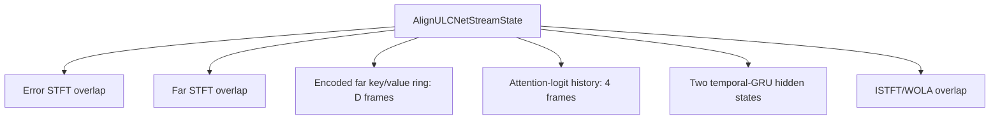

[索引](align_ulcnet_embedded_streaming_design_zh_TW.md) | [上一份](align_ulcnet_embedded_streaming_design_zh_TW.md) | [下一份](align_ulcnet_embedded_streaming_design_zh_TW_02_npu_boundary_validation.md) <!-- split-nav -->
## 6. Streaming Model State

真正 streaming 是每次輸入少量新資料、但歷史 state 持續存在；不是把完整
forward 切成多個互相獨立的 N-frame chunks。



目前層級的時間狀態判定：

| 模組 | 跨時間 state |
|---|---|
| C-SamFR、stream encoders | 無；time kernel = 1 |
| JointConv blocks | 無；time kernel = 1 |
| Q/K/V projection | 無；1x1 |
| Delay candidate | encoded far key/value ring，長度 D |
| Attention score conv | 需前 4 frames；time kernel = 5（全模型唯一 time kernel > 1 的層） |
| FGRU | 沿 frequency 運行，每個 time frame 獨立；⚠ bidirectional over frequency，版端每 frame 要跑正反兩個方向 |
| Two subband temporal GRUs | 必須保存每層 hidden state |
| Stage-2 mask conv | 無；time kernel = 1 |
| STFT/ISTFT | overlap/window state |
| BatchNorm2d（×6） | 無跨時間 state，但 train 模式對時間軸取統計——streaming 等價的唯一數學風險。必須 `eval()` 並 fold 進 conv（實測 train 模式 prefix 差 0.44、eval 模式差 5.6e-9） |

### 6.1 N 與 D 不同

- `N`：一次 NPU invocation 輸入幾個新 frames；可為 1、2、4 或 8。
- `D`：persistent far history 的 delay search span。

`N=1` 不代表 `D=1`。出貨 pipeline 是 `N=1`；若版端 batching
效率需要 `N=2/4`，states 仍必須跨 invocation 保留。

### 6.2 State RAM 粗估

16 kHz、512/256、float32、encoder width 26、32 key/value channels。state 以
完整 window 進出：K/V 各保存 D 幀（newest-first），logit 保存 5 幀（score conv
的 5 幀輸入，oldest-first），兩顆 2-layer temporal-GRU hidden 併成一個
`[1,4,1,128]`。graph 取輸入 window 的前 D-1 幀（logit 取後 4 幀）再接上新的
一幀，所以輸入與輸出 shape 相同；被丟掉的那一格只讓 shape 相等。Python
`DelayRingCell` 保存的就是同一個 D 幀 ring。

| State | D=8（16 kHz） |
|---|---:|
| encoded far key window | 26.0 KiB（8 幀） |
| encoded far value window | 26.0 KiB（8 幀） |
| attention-logit window（5 frames） | 5.0 KiB |
| 兩顆 2-layer temporal-GRU hidden（合併的 `h_gru`） | 2.0 KiB |
| STFT/WOLA overlap | 數 KiB |

NN persistent state 約 59.0 KiB（四個 state tensor 各一份 buffer，每個 `*_out`
就地綁定到輸入位址）；另加 STFT/WOLA 數 KiB。
GRU hidden = 2 blocks × 2 layers × 128 × 4 B = 2.0 KiB，GRU 無
cell state。上述不含 model weights、NPU activation scratch 與 backend alignment。
D=4 可再降低 key/value ring 與 logit window；最終數字必須由 export
後的 tensor layout 與板端 allocator 報告。

48 kHz 的 `ta_bins` 加倍（26 → 52），key/value window 跟著加倍，但
logit window 只隨 D 走、不隨 grid 走，所以整體不是兩倍。

adapter 驅動的是 `ulcnet_prepost` class 的一個 `ULCNET_IO_FREQ` 實例（頻譜進、
頻譜出、不做 transform），所以 adapter pool ＝ class 的 FREQ pool ＋ 32 B 的
adapter 自身結構，比只包 model_io 的 pool 多一個 class 前後處理 scratch。實測
`ulcnet_accelerator_adapter_get_mem_size()`（四個 state、特徵輸入與 `output`
staging、工作區）：

| adapter pool | D=4 | D=8 | D=16 | D=32 | D=64 |
|---|---:|---:|---:|---:|---:|
| 16 kHz（TA=26） | 46,096 B | 75,280 B | 133,648 B | 250,384 B | 483,856 B |
| 48 kHz（TA=52） | 87,056 B | 142,864 B | 254,480 B | 477,712 B | 924,176 B |

只要 model_io 的 K/V／logit／GRU state（`ulcnet_model_io_get_mem_requirements()`，
不含 class 的前後處理 scratch）：

| model_io pool | D=4 | D=8 | D=16 | D=32 | D=64 |
|---|---:|---:|---:|---:|---:|
| 16 kHz（TA=26） | 39,696 B | 68,880 B | 127,248 B | 243,984 B | 477,456 B |
| 48 kHz（TA=52） | 74,512 B | 130,320 B | 241,936 B | 465,168 B | 911,632 B |

adapter 與 model_io 的差額（16 kHz D=8：6,416 B）是 class 的前後處理 scratch。

過邊界的 persistent tensor 小計（不含特徵輸入／`output` staging 與工作區）：16 kHz D=8 為
59.00 KiB、48 kHz D=8 為 111.00 KiB；D=64 則是 458.00 KiB 與 874.00 KiB。

### 6.3 Attention MAC 粗估

只計 delay-dependent dot/weighted-sum/score 部分，約隨 D 線性：

```text
D=8  : 約 1.1 M MAC/s
D=64 : 約 8.6 M MAC/s
```

這不包含 Q/K/V、encoders、FGRU、temporal GRUs 與 mask head。必須同時量：

- 整體 cycles/hop；
- attention cycles/hop；
- NPU scratch peak；
- end-to-end 16 ms deadline margin。

## 7. STFT/WOLA 與 Latency Contract

Python offline feature path 使用 `center=True`。Embedded streaming 不可每個 chunk
各自呼叫 centered STFT；C 端建立持續的 analysis/synthesis buffers（audiolib 的
`AcStft`／`AcIstft`，`center` 0 的 rolling 分析）：

- periodic sqrt-Hann；
- FFT/window/hop = 512/512/256；
- error 與 far 使用同一 frame timestamp；
- synthesis 為對應的 50% overlap WOLA；
- 對外 latency 以 samples 實測記錄，不只由公式推測。

在本 grid（win=n_fft、hop=win/2、同一 sqrt-Hann 窗）下，centered 第 k 幀與
non-centered 第 k-1 幀覆蓋**完全相同的樣本**（逐 bit 同頻譜）——兩種 framing 的
穩態特徵相同，且 STFT→NN→ISTFT 鏈的穩態 I/O 延遲都是同一個 1 hop（16 ms，WOLA
收尾本來就要等下一幀）。所以 center 是**邊界與編號慣例**：真實差異只有
(a) 串流開頭第一幀（reflect 前綴 vs 冷啟動）造成的 recurrent-state start transient、
(b) 檔案級評測的幀數/邊界、(c) 幀時間戳語意。要真正壓延遲屬重訓等級手段
（非對稱窗、縮 hop）。

**4ch 的 latency contract**：4ch Align-ULCNet pipeline 的「加總後額外演算法延遲」是
**1 hop**（16 kHz 256 samples = 16 ms、48 kHz 512 samples = 10.67 ms），與 mono
範例（`pipelines/ulcnet/mono_alignulcnet/main.c`）相同。BF 產出的 beamformed error **頻譜**直接餵給模型（它已經是本 hop 的
sqrt-Hann 50%-overlap 單幀），中間沒有 beam WOLA→再 analysis 的來回，far 路也沒有
one-hop 補償 buffer；唯一的延遲來源就是本節的 ULCNet synthesis WOLA。`process()`
只有 hop #0 輸出零，之後 hop p 的輸出是 input hop p-1 的 beamformed error。每個 hop
從 hop #0 起都恰好一次 inference。

## 8. Delay 狀態機與 Fallback

兩個 pipeline 範例（`pipelines/ulcnet/mono_alignulcnet/main.c` 與
`pipelines/ulcnet/4ch_alignulcnet/main.c`，共用 `pipelines/ulcnet/ulcnet_nn_stage.{h,c}`）的行為一致：

- UNLOCKED：模型照常步進並套用成功輸出（far 本來就是 raw far）；
- delay_state 變為 CHANGED，或 FIXED 首次 UNLOCKED→LOCKED：`model->reset` 清除 far
  key/value ring、attention-logit history 與兩組 temporal GRU hidden，並 arm
  identity reprime；
- infer 失敗或輸出含非有限值（NaN/Inf）：該 frame 走 identity，永不進 WOLA；
- out-of-range 偵測不存在：超出可靠搜尋上界時狀態停在 UNLOCKED，與冷啟動不可區分。

identity reprime：邊界的 `model->reset` 之後，C 側 STFT 狀態仍連續，緊接著發射的幀其
512 樣本分析窗**跨在邊界上**（一半是切換前推入的 hop）。這些幀走 identity 且**完全
不呼叫 infer**（K/V、logit、GRU 都不前進），等 err 與 far 兩路窗都只含切換後的 hop 才
同時恢復 step 與 apply：mono 與 4ch 共用 `ULCNET_NN_STAGE_REPRIME_FRAMES=1`。這個常數由
`pipelines/ulcnet/mono_alignulcnet/tests/test_mono_ulcnet.c` 與 `pipelines/ulcnet/4ch_alignulcnet/tests/test_4ch_ulcnet.c` 的
`test_reprime_straddle_derivation()` 以脈衝標記在**無邊界對照跑**中量出並斷言，不是
寫死的估計值。

**4ch direct path**：BF 的 beamformed error **頻譜**直接當成模型的 error frame（它本來
就是本 hop 的 sqrt-Hann 50%-overlap 單幀），far 路用同一個 hop 的
`ac_stft_push_planar()`（`center` 0 的 `AcStft`），中間沒有 beam WOLA、沒有 error 路的
二次 analysis，也沒有 one-hop far buffer。兩路因此都從**當前** input hop 成幀，跨界幀
只剩邊界 hop 那一幀。邊界處理只做 `model->reset` ＋ arm reprime，不清任何 buffer
（C 側成幀狀態一路連續）。

**mono 的 rolling push**：mono 範例（`ulcnet/mono_alignulcnet/main.c` 經 `ulcnet/ulcnet_nn_stage`）的兩路 analysis 用 rolling center=False 的
`AcStft`（`ac_stft_push_planar()`）（自 hop#0 起每 hop 恰一幀、每 hop 至多一次推論），
排程與 AEC/BF seam 一致。reprime 每 hop 遞減（與每發射幀遞減相等），1 hop 端到端
延遲來自 synthesis 半窗 trim，幀 scratch 為 1 幀。

兩個變體的 production far branch 固定讀 caller 的 raw far，沒有 runtime mode；
export descriptor 固定記 RAW，`ulcnet_model_io.c` 的 validate 拒絕其他值。

⚠ **短延遲部署注意**：echo path 的 bulk delay 很小（linear filter 的 832-tap 涵蓋範圍內）
時，filter 未對齊就能收斂 → ERLE 超過 2.5 dB → Path-A already-cancelling 保護
（`delay_acquire_protect_converged`，Python/C 一致）會**永久擋下 first acquisition**，
`delay_state` 恆為 UNLOCKED。這不會停用 NN：模型能否處理該偏移由 D 決定。

## 9. D 的候選與 Checkpoint

16 kHz、hop=256 時：

| D | causal candidate | 最大 past offset |
|---:|---:|---:|
| 4 | 0--3 frames | 48 ms |
| 8 | 0--7 frames | 112 ms |
| 16 | 0--15 frames | 240 ms |
| 64 | 0--63 frames | 1008 ms |

縮小 D 不改 weight shape，但 export graph 的 shape 與 state pool 必須重產；
inference/export contract 必須記錄實際 D，不可靜默覆寫。

[索引](align_ulcnet_embedded_streaming_design_zh_TW.md) | [上一份](align_ulcnet_embedded_streaming_design_zh_TW.md) | [下一份](align_ulcnet_embedded_streaming_design_zh_TW_02_npu_boundary_validation.md) <!-- split-nav -->
