[索引](align_ulcnet_embedded_streaming_design_zh_TW.md) | [上一份](align_ulcnet_embedded_streaming_design_zh_TW_01_state_wola_delay.md) <!-- split-nav -->
## 10. NPU Model Boundary

產品邊界假設加速器完全 **stateless**：加速器不保存 K/V ring、
score history 或 GRU hidden。這些都是 CPU 管理的 caller-owned
static memory，每幀以普通 tensor input/output 傳給 graph。「NPU runtime
保存 state」在本文一律是指 CPU/driver context 保存，不表示模型
或加速器有隱藏 persistent state。

Align-ULCNet 是 PBFDKF 後的 RES+NR model；原始 `mic` 只進 CPU
線性 AEC，模型的 primary input 是 `linear_error`，不是 raw mic。

### 10.1 CPU 與 stateless model 的完整流程

```mermaid
flowchart LR
    subgraph CPU["CPU / DSP / external SRAM"]
        MIC["mic PCM hop"]
        FAR["far PCM hop"]
        AEC["Matched filter + PBFDKF"]
        ERR["linear_error PCM"]
        AFAR["raw far PCM"]
        ESTFT["sqrt-Hann STFT<br/>512 / 256"]
        FSTFT["sqrt-Hann STFT<br/>512 / 256"]
        FEAT["固定前端 fp32<br/>signed pow(0.3) + magnitude<br/>+ 壓縮域相位 cos/sin"]
        ERRI["error_mag / error_cos / error_sin<br/>各 [1,1,K]<br/>壓縮域 error RI 留在 model_io state"]
        FARRI["far_mag<br/>[1,1,K]"]
        KH["key_history<br/>[1,32,D,TA]<br/>caller pool；*_out 就地綁定"]
        VH["value_history<br/>[1,32,D,TA]<br/>caller pool；*_out 就地綁定"]
        LH["logit_history<br/>[1,32,5,D]<br/>caller pool；*_out 就地綁定"]
        GH["h_gru<br/>[1,4,1,128]<br/>caller pool；*_out 就地綁定"]
        CHECK["commit()：驗證 state"]
        INV["commit()：壓縮域 error × mask<br/>＋逆冪 fp32"]
        WOLA["WOLA / IFFT"]
        PCM["enhanced PCM hop"]

        MIC --> AEC
        FAR --> AEC
        AEC --> ERR --> ESTFT --> FEAT
        FAR --> AFAR --> FSTFT --> FEAT
        FEAT --> ERRI
        FEAT --> FARRI
        KH --> CHECK
        VH --> CHECK
        LH --> CHECK
        INV --> WOLA --> PCM
    end

    subgraph NPU["Stateless accelerator: one ONNX invocation / frame"]
        ENC["error/far encoders"]
        QKV["Q_now / K_now / V_now"]
        TA["TA: current + history<br/>score conv + softmax"]
        BODY["joint conv + FGRU<br/>two temporal GRUs"]
        MASK["complex_mask 1x1 Conv<br/>（graph 最後一個 op）"]
        ENH["output = 複數 mask（planar）<br/>[1,2,1,K]"]
        NEXT["完整下一個 state window（shape 同輸入）<br/>key/value/logit_history_out<br/>h_gru_out"]

        ENC --> QKV --> TA --> BODY --> MASK --> ENH
        QKV --> NEXT
        TA --> NEXT
        BODY --> NEXT
    end

    ERRI --> ENC
    FARRI --> ENC
    KH --> TA
    VH --> TA
    LH --> TA
    GH <--> BODY
    ENH --> INV
    NEXT -->|"同位址"| KH
```



每個 256-sample hop 產生一個 model frame，且每 hop 至多一次 inference。
rolling 分析（`AcStft`，`center` 0；mono 範例、4ch direct path、pre/post
class 的 TIME 模式全走這個）從第一次推入起就固定一幀一次 inference，沒有
priming 例外。centered 分析（`center` 1，0/2/1 幀發射，priming 期間的
第二次 push 會連續產生兩幀）不再有出貨 pipeline 呼叫，只剩
Python parity gate 使用。model graph 不收 PCM、不包 STFT/WOLA、不包 PBFDKF
或 delay state machine。

### 10.2 ONNX input/output contract

版端第一版固定 `batch=1, T=1`，RI 放在最後一維，不使用 ONNX
complex tensor。`D` 在 export 時固定；D=4 與 D=8 是不同 graph/
descriptor，雖然可共用同一份 checkpoint weights。
portable model-I/O ABI 限制 `2 <= D <= 64`；D=1 會讓 Slice 保留零幀，多數版端 runtime 無法穩定支援，只保留為 Python 評測模式。

固定前後端在 host fp32 執行：signed `pow(0.3)` 壓縮、兩路
magnitude、壓縮域相位 cos/sin 由 `ulcnet_model_io_prepare()` 內算，並把壓縮域
error 頻譜留在 model_io state；graph 只綁四個特徵輸入，各自持 PTQ scale，止於
`complex_mask` 1×1 Conv、輸出學到的 mask。壓縮域 error 乘 mask 與逆冪由
`ulcnet_model_io_commit()` 內做（fp32 乘積不融合，`-ffp-contract=off`；Python
對照 `export_onnx.host_back_end`）。

boundary 只有一種（layout 18）：四個 host 特徵輸入加四個 rank-4 state，每個
state 都有同 shape 的 `*_out`。沒有可選的 layout 旗標：前後端固定在 host，兩顆
GRU hidden 固定併成單一 `h_gru`（沿 dim 1 疊，`h_gru0` 的兩層在前；dim 0 是
singleton N，不是疊的軸）。版本號在 `export_onnx.py` 的 `LAYOUT_VERSION`，與
`ulcnet_model_io.h` 互鎖；3–17 退役。`inference.py calib` 在同一個 process
用同一個 model instance 匯出對應 graph，calibration report 的
`state_layout_version` 讀的是該 graph 的版號。

Inputs（K = `n_fft/2+1`，16k: 257、48k: 513；TA = `ta_bins` = `ceil(K/10)`，
16k: 26、48k: 52；D = `max_delay_frames`——見 [§1.3](align_ulcnet_embedded_streaming_design_zh_TW.md#13-48-khz-grid)）：

| tensor | float32 shape | 來源／用途 |
|---|---:|---|
| `error_mag` | `[1,1,K]` | 壓縮域 linear-error magnitude |
| `far_mag` | `[1,1,K]` | 壓縮域 far magnitude；far 固定取 raw far |
| `error_cos` | `[1,1,K]` | 壓縮域 error 相位 cos |
| `error_sin` | `[1,1,K]` | 壓縮域 error 相位 sin |
| `key_history` | `[1,32,D,TA]` | encoded far keys 的 window，newest-first（slot 0 = 上一幀，slot D-1 不被讀取） |
| `value_history` | `[1,32,D,TA]` | encoded far values 的 window，newest-first |
| `logit_history` | `[1,32,5,D]` | TA `(5,3)` score conv 的 5 幀 raw logits，oldest-first（frame 0 不被讀取） |
| `h_gru` | `[1,4,1,128]` | temporal subband GRU 0 的 2 layers，接著 subband GRU 1 的 2 layers |

Outputs：

| tensor | float32 shape | CPU 操作 |
|---|---:|---|
| `output` | `[1,2,1,K]` | 學到的複數 mask，planar（plane 0 實部、plane 1 虛部）；host 以壓縮域 error 頻譜乘上它、逆冪還原後送 WOLA/IFFT（`ulcnet_model_io_commit()`） |
| `key_history_out` | `[1,32,D,TA]` | 與 `key_history` 同一位址（就地綁定），下一幀的輸入 |
| `value_history_out` | `[1,32,D,TA]` | 與 `value_history` 同一位址 |
| `logit_history_out` | `[1,32,5,D]` | 與 `logit_history` 同一位址 |
| `h_gru_out` | `[1,4,1,128]` | 與 `h_gru` 同一位址 |

### 10.2.1 full-window、同位址的 state 邊界

graph 回**每個 state 的完整下一個 window**，shape 與對應輸入完全相同；輸出依序為
`output`、`key_history_out`、`value_history_out`、`logit_history_out`、
`h_gru_out`。位移在 graph 內、用輸入端的 Slice：K/V 取輸入 window 的 slot
`0..D-2`（Slice axis 2，start 0、end D-1，step 1）再把新一幀 Concat 在**前面**；
logit window 取輸入的 frame `1..4`（start 1、end 5）再把新的一列 Concat 在**後面**。
Concat 的結果同時是 attention 的候選與 `*_out`，沒有任何 state 輸出由 Slice 產生；被
丟掉的那一格（K/V 的 slot D-1、logit 的 frame 0）只讓輸入與輸出 shape 相同，graph
不讀它。匯出 metadata 為 `boundary: stateless_one_frame_full_state`、
`state_binding: in_place_same_address`、`cpu_delta_state_update: false`。

- **四個 state 就地綁定**：`key_history`、`value_history`、`logit_history`、
  `h_gru` 在 caller pool 內各一份、位址在實例壽命內固定
  （`ulcnet_model_io_prepare()` 把 `outputs->*_out` 指到同一個 pool 位置）。runtime
  把每個 `*_out` 綁到同名輸入的位址，必須先讀完**所有** state 輸入、才寫任何 state
  輸出。沒有複製路徑，也沒有 ping-pong；CPU 端沒有
  ring helper。
- **layout**：`ULCNET_MODEL_IO_LAYOUT_VERSION` = 18，`ULCNET_PREPOST_CARVE_VERSION`
  = 6；3–17 退役。
- **`prepare()`** 只對 `output` 預填 NaN，state 不預填（它同時是下一幀的輸入）。
- **`commit()` 不更新 state**：先檢查 `output`（mask）有限、`h_gru` 有限，以及每個
  channel 中 graph 這一幀新寫的那一格（K/V 的 slot 0、logit 的最後一幀）有限。
  任何一處非有限值時 state 已被覆寫、無法回滾，所以四個 state 全部歸零（冷啟動）、
  state generation 加一、transaction 丟棄、呼叫端的輸出不動、回 -1。較舊的格子與被丟掉
  的那一格不重查：留在那裡的非有限值會在下一幀進到 `output` 而被擋下。「寫一半」只能以非有限值偵測。
- **`frame_skip`** 不動任何 state（視同回報失敗的 runtime 沒寫）。
- **state generation**：`ulcnet_model_io_state_generation()`／`ulcnet_prepost_state_generation()`／
  `ulcnet_accelerator_adapter_state_generation()` 數 C 端把 state 清零的次數
  （`reset` 與被拒絕的 commit 各加一，新建實例為 0）。定點 accelerator 的 state 緩衝在 C 清零時
  不會跟著變，板端 sample 比較這個值，變了就用量化後的 0 重填 state 輸入。第一個 hop 的
  state 為 reset 值 0；定點 runtime 的 0 是否等於量化後的 0 由量化工具鏈確認，尚未驗證。
- **Python reference**：`export_onnx.py` 的 `next_state(outputs)` 只是輸出的尾段。

`query_now` 與 error-encoder feature 下一幀不再使用，不列為 output。
`delay_distribution [1,1,D]` 只能作 debug output，production graph 預設不輸出。

ring 的邏輯語意：

```text
key_history (input)  = [K(t-1), K(t-2), ..., K(t-D)]    D 幀，slot D-1 不被讀
K candidates at t    = [K_now, K(t-1), ..., K(t-D+1)]   = Concat(K_now, Slice(key_history, 0..D-2))
key_history_out      = K candidates at t                D 幀，是下一個 hop 的輸入
```

stream start/pipeline reset 必須清空所有 state。`delay_state=CHANGED`
至少清空 K/V ring 與 logit history；第一版為降低風險，連兩組 GRU
hidden 一起清空，之後才 A/B 「只清 TA」。清空後仍跨在邊界上的分析幀由
pipeline 端的 identity reprime 擋掉（不 step 模型），見 [§8](align_ulcnet_embedded_streaming_design_zh_TW_01_state_wola_delay.md#8-delay-狀態機與-fallback) 的
identity reprime。

### 10.3 C 交付邊界

本專案交付：

- `ulcnet_process.c/.h`：`ulcnet_framing_config()` 描述 audiolib 的 sqrt-Hann `AcStft`／`AcIstft`
  （RI frame）。兩種 analysis 排程：`center` 1（centered、0/2/1 出幀排程，
  不再有出貨 pipeline 呼叫，只剩 Python parity gate 使用）與
  `center` 0（rolling、每次推入固定出一幀，與同一 hop 的 centered
  最後一幀逐 bit 相同；mono 範例的兩路、4ch direct path 的 far 路，以及兩個 AIAEC
  pre/post class 的 TIME 模式都在用）。同一個 `AcStft` 不可混用兩種 `center`。
- model-I/O/state `c/.h`：caller-owned memory requirement/init/reset、四個
  state tensor 的保存、commit（驗證 state、壓縮域 error × mask、逆冪；不更新 state）、
  state generation、descriptor/layout validation。沒有 CPU ring update，也沒有複製路徑。
  RAM 必須隨 D 縮小。
- streaming ONNX exporter：單幀 stateless graph，explicit state inputs
  （完整 window）+ 同 shape 的 full-window outputs，同時生成
  machine-readable descriptor，並以 `validate_inplace_state_contract` 驗證寫出的檔案。
- PyTorch `forward_stream()` vs export runtime 的長串流、reset 與 mutation
  parity tests。

本專案不交付：

- 板端 NPU driver/runtime implementation。
- 加速器內部 persistent state（不存在）。
- 特定產品的狀態機與板端 accelerator 呼叫。共用 CPU state adapter 與
  mono/4ch fail-open wiring 在 `pipelines/`，其中板端 callback 保留為
  board TODO。
- PBFDKF/matched-filter 演算法改動。

外層 `UlcnetModel.infer(user, error, far, enhanced)` 仍可保留；`user`
指向 CPU 的 accelerator context + external state buffers。pipeline 不需看到
K/V/GRU 細節，`reset(user)` 負責清空外部 state。

出貨 graph 內、需要 runtime 支援的 operator inventory：

- unfold/ring gather；
- Slice（K/V/logit window 位移，在 graph 內，輸入端、axis 2、step 1）與 Concat；
- softmax；
- bidirectional GRU（沿 frequency）；
- stateful unidirectional GRUs；
- PReLU/ELU/BatchNorm folding。

signed `pow(0.3)`／inverse power 與 `atan2/cos/sin` **不在出貨 graph 內**：
由 `ulcnet_model_io_prepare()`/`ulcnet_model_io_commit()` 以 host fp32
執行，graph 內沒有這些算子。
不要在 operator scan 前任意改數學式，否則 checkpoint parity 不明。

## 11. 驗證項目

### 11.1 Correctness

- AEC exposed aligned far 與 PBFDKF consumed far 同 hop、同 samples。
- reset/delay change 後不讀 stale context/state。
- scalar/NEON 適用路徑全部測試。
- full-utterance vs streaming comparison 明確說明 bit-exact 或 tolerance；不可只看 finite。
- PyTorch/export/board tensor 逐層 max/RMS error。
- 10 分鐘以上 streaming：無 NaN/Inf、無 heap、無 state growth。

### 11.2 場景

- far-end single talk；
- near-end single talk；
- double-talk；
- cold start；
- 10--120 ms dataset bulk delay；
- 裝置實際最大正常 delay；
- delay jump/jitter；
- echo-path change；
- SRO/clock drift；
- render underrun/overrun；
- reset/route change；
- delay out of range。

### 11.3 指標

- AECMOS echo/deg；
- ERLE；
- STOI/PESQ 或既有 NR quality gate；
- near-end attenuation 與 double-talk guard；
- lock/re-lock time；
- cycles/hop、p99 latency、deadline miss；
- persistent RAM、NPU scratch peak、model size。

### 11.4 板端整合確認

1. NPU 是否支援 graph 的所有算子與 explicit-state I/O？
2. Board adapter 是否從 exporter descriptor 取得 D/tensor shapes，而非手寫？
3. CPU 是否在每次 invoke 後驗證全部 model outputs finite，再 commit state？
4. MATCHED/FIXED alignment transition 是否在同一 hop 清除 K/V/logit/GRU state？
5. route delay 超出 n 的可靠範圍時，產品如何記錄、告警與選擇 fallback？
6. board profiler 下 D=4/8/16 的 state RAM、NPU time 與整體 hop margin 為何？
[索引](align_ulcnet_embedded_streaming_design_zh_TW.md) | [上一份](align_ulcnet_embedded_streaming_design_zh_TW_01_state_wola_delay.md) <!-- split-nav -->
